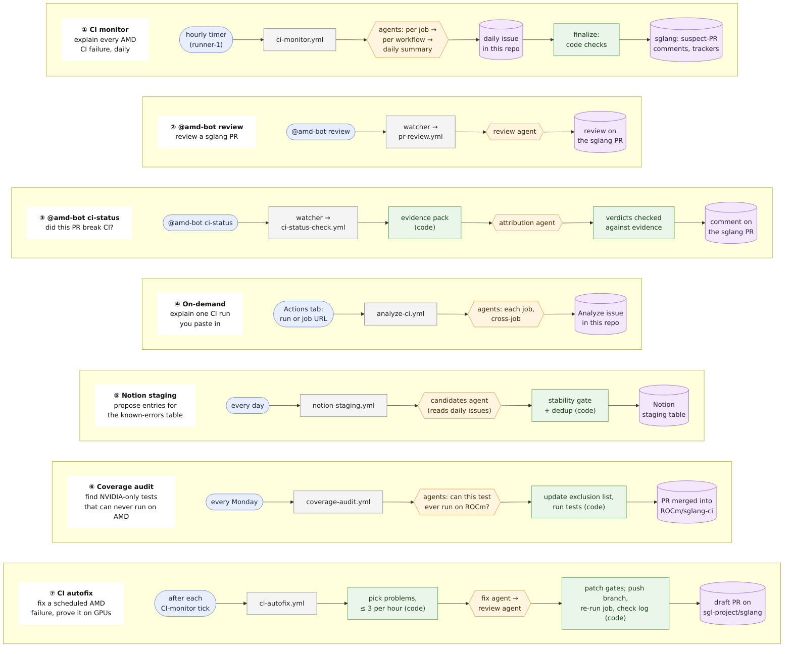

# sglang-ci-bot

The AMD CI bot for [sglang](https://github.com/sgl-project/sglang). It watches AMD CI, explains failures, names the PRs that broke it, and reviews PRs on request. It posts as **[amd-bot](https://github.com/amd-bot)**. The analysis is done by Claude Code agents running on self-hosted runners that reach Claude through the AMD LLM Gateway.

This README is the map of the repo: what each part does and why. Implementation details live in the code it links to. If you read only two sections, read [The big picture](#1-the-big-picture) and [Design rules](#3-design-rules). **Changing the repo, by hand or with an AI tool?** Read [Changing this repo](#changing-this-repo) first.

**Contents**

1. [The big picture](#1-the-big-picture)
2. [Feature map](#2-feature-map)
3. [Design rules](#3-design-rules) · [Hidden markers](#hidden-markers-where-the-state-lives) · [Changing this repo](#changing-this-repo)
4. [How an agent runs](#4-how-an-agent-runs)
5. [Features](#5-features): [CI monitor and daily report](#51-ci-monitor-and-the-daily-report) · [Suspect PR comments](#52-suspect-pr-comments) · [Failure Trackers](#53-failure-trackers) · [PR commands](#54-pr-commands-the-comment-watcher) · [PR review](#55-pr-review) · [PR CI status](#56-pr-ci-status-check) · [On-demand analysis](#57-on-demand-analysis) · [Notion staging](#58-notion-staging) · [Coverage audit](#59-coverage-exclusion-audit) · [CI autofix](#510-ci-autofix)
6. [Operations](#6-operations)
7. [Reference](#7-reference)

---

## 1. The big picture

Each feature is one lane. The bold box on the left says what it is for; the rest reads left to right: what starts it, which workflow runs, where the LLM is used, what code checks it, and where the result goes.



<sub>Source: [`docs/architecture.mmd`](docs/architecture.mmd) (Mermaid). After editing it, re-render the image with [`docs/render-diagram.sh`](docs/render-diagram.sh); `tests/test_readme.py` fails if the image is older than its source.</sub>

**Colors.** 🔵 trigger · ⬜ GitHub Actions workflow · 🟧 LLM agents · 🟩 deterministic code · 🟪 where results go.

**The one pattern to notice.** Wherever a result leaves this repo, a green box stands between the orange LLM and the purple output: the LLM proposes, and code decides what gets out. That is design rules [R2](#r2) and [R4](#r4) in picture form. Lane ⑦ has two: code picks what the agents work on, and code checks the patch and the GPU re-run before anything is published. Lanes ① and ④ write straight from an agent, but only into this repo's own issues. **Lane ② is the known exception:** the PR review posts the agent's text without a code gate (see R2).

Three more things the picture does not show:

- **Everything runs on the self-hosted runner containers** (`runner/`), because only they can reach the LLM gateway. The work runs as GitHub Actions jobs of this repo, plus two loops on runner-1: the hourly CI-monitor timer, and the comment watcher behind lanes ② and ③.
- **Every agent goes through one function**, [`claude_code_analyze()`](scripts/utils.py). Agents get their instructions from files under [`agent/`](agent/), never from strings in Python ([§4](#4-how-an-agent-runs)).
- **The daily issue is also state.** The summary and the `finalize` steps of lane ①, and lanes ⑤ and ⑦, read the analyses back from it; lane ⑦ also keeps its own state there. Runners keep nothing that matters.

---

## 2. Feature map

| Feature | Trigger | Workflow → script | Agent tasks | Writes to |
|---|---|---|---|---|
| [CI monitor and daily report](#51-ci-monitor-and-the-daily-report) | runner-1, hourly | [`ci-monitor.yml`](.github/workflows/ci-monitor.yml) → [`monitor_ci.py`](scripts/monitor_ci.py), [`daily_cross_workflow_summary.py`](scripts/daily_cross_workflow_summary.py), [`order_daily_comments.py`](scripts/order_daily_comments.py), [`runner_health.py`](scripts/runner_health.py), [`auto_rerun.py`](scripts/auto_rerun.py) | Job Failure Analysis, Cross-Job Summary, Cross-Run Pattern Analysis, Daily Cross-Workflow Summary | Daily issue in this repo |
| [Suspect PR comments](#52-suspect-pr-comments) | `finalize` job of the CI monitor | [`suspect_pr_comments.py`](scripts/suspect_pr_comments.py) | — | Comments on merged sglang PRs; a log comment on the daily issue |
| [Failure Trackers](#53-failure-trackers) | `finalize` job of the CI monitor | [`failure_tracker.py`](scripts/failure_tracker.py) | Failure Tracker Data | One issue per tracked workflow on sgl-project/sglang |
| [PR commands](#54-pr-commands-the-comment-watcher) | `@amd-bot …` on a sglang PR | runner-1 daemon + [`comment-watcher.yml`](.github/workflows/comment-watcher.yml) → [`watch_comments.py`](scripts/watch_comments.py) | — | Dispatches the two workflows below; help replies |
| [PR review](#55-pr-review) | `@amd-bot review` | [`pr-review.yml`](.github/workflows/pr-review.yml) → [`review_pr.py`](scripts/review_pr.py) | PR Code Review | One comment on the sglang PR |
| [PR CI status](#56-pr-ci-status-check) | `@amd-bot ci-status` | [`ci-status-check.yml`](.github/workflows/ci-status-check.yml) → [`check_ci_for_pr.py`](scripts/check_ci_for_pr.py), [`ci_evidence.py`](scripts/ci_evidence.py), [`ci_verdicts.py`](scripts/ci_verdicts.py), [`suggested_tests.py`](scripts/suggested_tests.py) | PR CI Status Check | One comment on the sglang PR |
| [On-demand analysis](#57-on-demand-analysis) | Actions tab, paste a run/job URL | [`analyze-ci.yml`](.github/workflows/analyze-ci.yml) → [`analyze_url.py`](scripts/analyze_url.py) | Job Failure Analysis, Cross-Job Summary | An `[Analyze]` issue in this repo |
| [Notion staging](#58-notion-staging) | 12:00 UTC daily | [`notion-staging.yml`](.github/workflows/notion-staging.yml) → [`stage_notion.py`](scripts/stage_notion.py) | SGLang AMD CI Staging Candidates | Notion staging database |
| [Coverage audit](#59-coverage-exclusion-audit) | Mondays 16:07 UTC | [`coverage-audit.yml`](.github/workflows/coverage-audit.yml) (code lives in ROCm/sglang-ci) | its own prompt, in ROCm/sglang-ci | A PR merged into ROCm/sglang-ci |
| [CI autofix](#510-ci-autofix) | after each CI-monitor tick | [`ci-autofix.yml`](.github/workflows/ci-autofix.yml) → [`autofix.py`](scripts/autofix.py) and its `autofix_*.py` modules | CI Autofix, CI Autofix Review | `bingxche/autofix-*` branches and draft PRs on sgl-project/sglang, as bingxche; a log comment on the daily issue |

Supporting code:
- [`utils.py`](scripts/utils.py): GitHub helpers, the agent harness, worktrees, log parsing.
- [`ensure_daily_issue.py`](scripts/ensure_daily_issue.py): creates the daily issue.
- [`eval_ci_status.py`](scripts/eval_ci_status.py): scores CI-status replays.
- [`validate_live.py`](scripts/validate_live.py): runs any use case on a runner without writing to GitHub.
- [`check_pr_rules.py`](scripts/check_pr_rules.py) with [`pr-checks.yml`](.github/workflows/pr-checks.yml): enforce the [rules for changes](#changing-this-repo) on every PR.
- [`autofix_audit.py`](scripts/autofix_audit.py): checks CI autofix against its done criteria: dispatch-recipe coverage, every bot PR, and every hour of autofix state.

---

## 3. Design rules

The decisions everything else follows, grouped by what they protect. Each has a stable ID, so a PR can say which rules it touches. Each also says **why** it exists and **what keeps it true**; rules kept only by review are marked *review only*.

### Safety: what the bot can touch

<a id="r1"></a>**R1. Agents read; code writes.**
- Every agent works in its own git worktree, at the exact commit under study, and loads no settings from that checkout (`--setting-sources user`). Developer skills are disabled.
- Its environment carries no posting token, and only a read-only one when `AGENT_GH_TOKEN` is set. The two CI autofix agents get no GitHub token at all.
- Only Python code writes to GitHub or Notion.
- One agent edits files: the CI Autofix agent changes its own worktree, with an allowlist of tools (read, edit, `pytest`, `pre-commit`, read-only git) and every other tool call denied. Code commits that change, pushes the branch, re-runs the job and opens the PR, in a separate job that runs no agent and is the only one holding `AUTOFIX_TOKEN`: code an agent runs (a test it wrote) can read its parent processes' environment, so stripping a token from the agent's own environment is not enough.

*Why:* agents read text anyone can write (PR diffs, logs, a PR's own `.claude/settings.json`, whose hooks once could run on our runners). *Kept by:* [`tests/test_agent_tasks.py`](tests/test_agent_tasks.py) (CLI flags), [`tests/test_ci_verdicts.py`](tests/test_ci_verdicts.py) (agent environment), [`tests/test_autofix.py`](tests/test_autofix.py) (autofix tools and environment).

<a id="r2"></a>**R2. Every write outside this repo passes a code gate.**
- New writers start in dry-run behind a repository variable. **CI autofix is the exception**: the repo owner chose to run it live from the start (2026-11-09). In its place: `AUTOFIX_MODE=off` stops it at once; at most `AUTOFIX_MAX_PER_HOUR` problems start per hour; it opens only drafts, and only after the failing job passed on AMD GPUs; hidden markers keep it from repeating itself.
- Posts are capped per tick and made at most once per PR (hidden markers).
- The bot @-mentions only the person who ran a command, and on a suspect PR comment the people who made that PR: its author, plus a cc to whoever merged it, its co-authors and its reviewers (bots dropped, at most [`MAX_CC`](scripts/suspect_pr_comments.py)), so a break reaches someone even when the author is away. One more: CI autofix's queue notice on the daily issue mentions the owner of its switch ([`NOTIFY_USER`](scripts/autofix_config.py)).

*Why:* a wrong comment on someone else's PR costs trust that is hard to win back. *Kept by:* [`tests/test_suspect_pr_comments.py`](tests/test_suspect_pr_comments.py), [`tests/test_autofix.py`](tests/test_autofix.py).

**Known gap:** `@amd-bot review` posts the review agent's text as it is, with no code check in between. Closing it (code checks plus verifier agents on every finding) is an open proposal.

<a id="r3"></a>**R3. People decide.** The bot reports, attributes and suggests triage steps. It never approves, merges, prioritizes or reruns sglang work. Three automated writes go further:
- the coverage audit merges, into ROCm/sglang-ci, exclusion entries that code validated and tested;
- CI autofix opens **draft** PRs on sglang. It never marks them ready, merges them or asks anyone to review them, and the jobs it re-runs are on its own branches.
- [auto-rerun](#auto-rerun) re-runs the failed jobs of a scheduled sglang run once, and only when code (log patterns, no agent) finds a transient network or infrastructure error. A run with any real failure among several transient ones is left alone.

*Why:* priority and merging need context the bot does not have. *Kept by:* review only.

### Truthfulness: what the bot says

<a id="r4"></a>**R4. The LLM judges; code decides and keeps state.** An agent finds and explains. Plain Python decides what is published and keeps every piece of state. For example:
- an agent names a suspect PR, and [`check_suspect()`](scripts/suspect_pr_comments.py) decides whether to comment;
- an agent extracts tracker rows, and [`merge_state()`](scripts/failure_tracker.py) owns `first_seen`;
- an agent gives CI-status verdicts, and [`ci_verdicts.validate()`](scripts/ci_verdicts.py) checks them against the evidence;

*Why:* models are good at reading logs and code, and unreliable at counting, remembering dates and following thresholds. *Kept by:* the tests of each of those functions.

<a id="r5"></a>**R5. Claims carry evidence.** The Ground Rules in [`agent/ground-rules.md`](agent/ground-rules.md) bind every task:
- analysis is at the test-file and test-function level;
- every commit SHA is verified, and every SHA, PR and job is a link;
- every causal claim has a confidence label (`FACT` … `SPECULATION`) and lists its disconfirming evidence;
- an in-flight fix PR is looked up before a fix is suggested;
- only completed runs count in trends.

*Why:* an unsupported claim sends engineers chasing the wrong cause. *Kept by:* the verification steps of R4 where output is published; review only elsewhere.

<a id="r6"></a>**R6. Fail closed.** Agent mode never falls back to a single-shot API call. When an agent fails, the bot publishes an "agent did not work" notice ([`agent_failure_notice()`](scripts/utils.py)) where the output would have gone, and the job fails. A verification step that cannot finish blocks posting.

*Why:* a confident shallow answer is worse than an honest "not available". *Kept by:* [`tests/test_agent_failures.py`](tests/test_agent_failures.py).

### Sustainability: how the repo stays understandable

<a id="r7"></a>**R7. Instructions live only in [`agent/`](agent/).** Python prompts are data: a `Task:` line plus metadata. Methodology and output format live in `agent/tasks/<task>.md`, and rules for every task in `agent/ground-rules.md`. [`AGENT_TASKS`](scripts/utils.py) maps each task to its file and model.

*Why:* behavior can then be reviewed as prose, in one place. *Kept by:* [`tests/test_agent_tasks.py`](tests/test_agent_tasks.py).

<a id="r8"></a>**R8. State lives on GitHub; runners are disposable; writes are idempotent.** Comments and issues carry [hidden markers](#hidden-markers-where-the-state-lives), so any tick can be re-run, any runner can take any job, and a host can be rebuilt from scratch.

*Why:* the runners are containers on one machine that gets rebuilt. *Kept by:* each feature's tests (re-runs, dedup).

<a id="r9"></a>**R9. Cost is bounded.**
- Every agent run has a turn limit and a timeout.
- Every fan-out has a cap: agents per matrix job, reviewers, findings verified, suspects verified per tick, autofix problems started per hour (each at most two attempts and two GPU runs).
- Every task's model is chosen for its stakes (most use the default model; `AGENT_TASKS` can give one a cheaper model). Both CI autofix tasks are pinned to Opus 5.5 1M at effort max: `AGENT_MODEL_<TASK>` cannot change them, and they never fall back to another model ([R6](#r6)).

*Why:* one loop without a bound spends the team's gateway quota. *Kept by:* review only. The limits are in the [environment variables](#environment-variables) table.

<a id="r10"></a>**R10. Agent changes are measured on real data.** A change to an agent's instructions or model is run on real inputs before merge, with [`validate_live.py`](scripts/validate_live.py), a CI-status replay, or a linked run, and the PR says how.

*Why:* a prompt has no compiler; its only test is its output. *Kept by:* the `Validated:` line that [`check_pr_rules.py`](scripts/check_pr_rules.py) requires.

<a id="r11"></a>**R11. This README is the map.** A change in behavior updates the matching section in the same PR. *Kept by:*
- [`tests/test_readme.py`](tests/test_readme.py): links, function names and lists match the code, and every script, workflow, agent task and environment variable is mentioned;
- [`check_pr_rules.py`](scripts/check_pr_rules.py): a behavior change without a README change fails.

### Hidden markers (where the state lives)

| Marker | Where | Meaning |
|---|---|---|
| `<!-- processed_job_ids: … -->` | each workflow's comment on the daily issue | jobs already analysed today; not analysed again |
| `<!-- ci-monitor-part: i/n -->` | workflow comments | a report split over several comments (60 KB limit) |
| `<details data-job-id data-run-url data-started-at>` | inside workflow comments | one per-job analysis; the only thing [`parse_job_analyses_from_comment()`](scripts/monitor_ci.py) reads back |
| `<!-- daily-cross-workflow-summary:start/end -->` | daily issue body | the summary, pinned above all comments |
| `<!-- ci-monitor-runner-health:start/end -->` | daily issue body, above the summary | the Runner health section, rewritten every tick |
| `<!-- ci-monitor-job-clusters:v1 … -->`, `<!-- ci-monitor-suspect-prs:v1 … -->` | inside the summary | job → cluster map and suspect PRs, for the finalize steps |
| `<!-- R386 -->`, `<!-- next-free-id: R387 -->` | inside the summary, at each problem's heading or row, and in its footer | the problem (cluster) IDs, which the summary keeps out of its visible text; tomorrow's summary reuses them |
| `<!-- ci-monitor-cross-run-summary: <wf> -->` | daily issue | a workflow's cross-run comment |
| `<!-- ci-monitor-suspect-pr-log -->` | daily issue | every suspect decision this tick, and why |
| `<!-- amd-bot-suspect-pr:<cluster> -->`, `<!-- amd-bot-suspect-fix:<pr> -->` | sglang PRs | a suspect comment / a fix-review request was posted |
| `<!-- ci-failure-tracker-state: … -->` | Failure Tracker issue body | every failure's `first_seen` / `last_seen` |
| 🚀 reaction by amd-bot | the `@amd-bot` comment | the command was claimed; no other watcher dispatches it |
| `<!-- ci-autofix-log -->` with `<!-- ci-autofix-state:v1 … -->` | daily issue | CI autofix's log and state: per problem its attempts, branch, dispatched run and PR; the problems started each hour; who was notified. Carried over from the latest earlier day |
| `<!-- ci-autofix-queue-notice -->` | daily issue | a notice that @-mentions the owner when problems first wait for their hour |
| `<!-- amd-bot-autofix: R386 -->`, `<!-- amd-bot-autofix-data:v1 … -->` | the bot's draft PRs on sglang | the problem the PR fixes; the workflow, jobs, tests and GPU run that [`autofix_audit.py`](scripts/autofix_audit.py) re-checks |

### Changing this repo

These rules apply to every change, whether typed by hand or written by an AI tool. [`AGENTS.md`](AGENTS.md) is the only file that holds them, for every tool. Codex, Cursor, Copilot and most others read it natively; Claude Code reads it through [`CLAUDE.md`](CLAUDE.md), which is the single line `@AGENTS.md`. Any tool-specific rules file may only point to `AGENTS.md` ([`tests/test_agent_rules.py`](tests/test_agent_rules.py) enforces this), so there is never a second copy to keep in sync. And whichever tool wrote a change, [`pr-checks.yml`](.github/workflows/pr-checks.yml) checks the result.

1. **Read §1–§3 first.** Extend the existing patterns (the agent harness, hidden markers, code gates, dry-run variables) rather than inventing parallel ones.
2. **Stay on direction.** Do not break a design rule silently. A change that bends one names it in the PR, says why, and updates the rule here, which needs the repo owner's approval.
3. **One concern per PR.** No drive-by refactors, renames or reformatting, so every diff is reviewable.
4. **Update this README in the same PR**, following the section map in `AGENTS.md`.
5. **Test script changes in the same PR.** A change to `scripts/*.py` adds or updates a test in `tests/`, or the PR says why none fits.
6. **Fill in the four lines of the [PR template](.github/pull_request_template.md):**
   - `README:` the sections updated, or `not needed — <reason>`;
   - `Tests:` the tests added or changed, or `not needed — <reason>`;
   - `Design rules:` `none`, or the rule IDs touched;
   - `Validated:` how an agent change ran on real data (R10).

[`pr-checks.yml`](.github/workflows/pr-checks.yml) runs the unit tests and [`check_pr_rules.py`](scripts/check_pr_rules.py) on every pull request. It fails a PR that misses any of the above. Making it a required status check for `main` in branch protection is what makes the rules binding.

---

## 4. How an agent runs

Every agent run goes through [`claude_code_analyze()`](scripts/utils.py):

1. The prompt's first line names the task (`Task: Job Failure Analysis`). [`AGENT_TASKS`](scripts/utils.py) maps the task to its instructions file and model; an unknown task fails before anything starts.
2. The instructions, [`agent/ground-rules.md`](agent/ground-rules.md) followed by `agent/tasks/<task>.md` ([`agent_instructions()`](scripts/utils.py)), are passed with `--append-system-prompt`. Nothing is read from the checkout's own `CLAUDE.md` or `.claude/`.
3. Context files the script prepared (logs, evidence packs, other agents' output) are written to `.ci-context/` in the working directory and removed afterwards.
4. It runs `claude -p` in the worktree:
   - flags: `--setting-sources user --disable-slash-commands --dangerously-skip-permissions`, with a turn limit and a timeout. A task with a tool allowlist (`tools` in its `AgentTask`) runs with `--restricted --permission-mode dontAsk --allowedTools …` instead, so any other tool call is denied and file tools stay in the working directory; a task with an `effort` adds `--effort`;
   - environment: no `BOT_PAT`, `AUTOFIX_TOKEN` or `LLM_GATEWAY_KEY`, and `AGENT_GH_TOKEN` in place of `GH_PAT` when set. A task with `github_token=False` gets no GitHub token at all.
5. The text output is returned. When the final message misses the expected report (empty, or overwritten by a follow-up), the report is recovered from the session log. When `AGENT_ARCHIVE_DIR` is set, the prompt and session (with its subagent logs and the large tool outputs it keeps in separate files) are archived with secrets redacted.

Each agent works in an isolated worktree of a shared sglang clone ([`ensure_sglang_repo()`](scripts/utils.py), [`create_agent_worktree()`](scripts/utils.py)), checked out at the exact commit the CI run or PR used. The clone is re-made if it is broken (an interrupted clone once left runner-7 with no `HEAD`).

| `Task:` | Instructions | Model | Called from |
|---|---|---|---|
| Job Failure Analysis | [`job-failure-analysis.md`](agent/tasks/job-failure-analysis.md) | default | [`analyze_job_with_agent()`](scripts/utils.py) |
| Cross-Job Summary | [`cross-job-summary.md`](agent/tasks/cross-job-summary.md) | default | [`cross_job_analysis()`](scripts/utils.py) |
| Cross-Run Pattern Analysis | [`cross-run-pattern-analysis.md`](agent/tasks/cross-run-pattern-analysis.md) | default | [`maybe_publish_cross_run_summary()`](scripts/monitor_ci.py) |
| Daily Cross-Workflow Summary | [`daily-cross-workflow-summary.md`](agent/tasks/daily-cross-workflow-summary.md) | default | [`build_and_publish_summary()`](scripts/daily_cross_workflow_summary.py) |
| Failure Tracker Data | [`failure-tracker-data.md`](agent/tasks/failure-tracker-data.md) | default | [`run_agent_extraction()`](scripts/failure_tracker.py) |
| SGLang AMD CI Staging Candidates | [`staging-candidates.md`](agent/tasks/staging-candidates.md) | default | [`analyze()`](scripts/stage_notion.py) |
| PR CI Status Check | [`pr-ci-status-check.md`](agent/tasks/pr-ci-status-check.md) | default | [`check_ci_for_pr()`](scripts/check_ci_for_pr.py) |
| PR Code Review | [`pr-code-review.md`](agent/tasks/pr-code-review.md) | default | [`review_pr_with_agent()`](scripts/review_pr.py) |
| CI Autofix | [`ci-autofix.md`](agent/tasks/ci-autofix.md) | `Claude-Opus-5.5[1m]`, effort max, pinned | [`run_fix_agent()`](scripts/autofix_agents.py) |
| CI Autofix Review | [`ci-autofix-review.md`](agent/tasks/ci-autofix-review.md) | `Claude-Opus-5.5[1m]`, effort max, pinned | [`run_review_agent()`](scripts/autofix_agents.py) |

**Models.** Every task uses the runner's `ANTHROPIC_MODEL` (`opus[1m]`) unless `AGENT_TASKS` gives it its own.
- `AGENT_MODEL_<TASK>` overrides the model for one task, e.g. `AGENT_MODEL_FAILURE_TRACKER_DATA=sonnet`.
- An alias such as `sonnet` is used only when `claude.env` maps it (`ANTHROPIC_DEFAULT_SONNET_MODEL`); otherwise the task keeps the default model.
- If the gateway has no deployment of the requested model, the task is retried once with the default ([`task_model()`](scripts/utils.py)).
- An `AgentTask` can also set `effort` (passed as `--effort`) and `pinned`. A pinned task (the two CI autofix tasks) ignores `AGENT_MODEL_<TASK>`, is never retried with the default model, and is checked after the run: if the gateway does not serve its model, or the session log shows any other model, it fails with `ModelUnavailable` ([`claude_code_analyze()`](scripts/utils.py)). A pinned task that times out returns nothing.

**Output contracts.** Reports start with a fixed first line (`### Commit Info`, `**Counts**:`, `# Daily Cross-Workflow Summary`), and the harness strips anything before it. Machine-readable results come in hidden or fenced blocks that code parses and validates: `ci-status-verdicts`, `job-clusters`, `suspect-prs`, and tracker data.

---

## 5. Features

### 5.1 CI monitor and the daily report

**Purpose.** One GitHub issue per UTC day in this repo, `[CI Monitor] Daily Report - <date>`. It holds a per-workflow failure report for every monitored AMD workflow, plus a cross-workflow summary pinned at the top of the issue body, under a Runner health line that flags workflows whose jobs are not getting runners.

**Flow** ([`ci-monitor.yml`](.github/workflows/ci-monitor.yml), dispatched hourly by runner-1's [`entrypoint.sh`](runner/entrypoint.sh)):

1. **prepare**: [`ensure_daily_issue.py`](scripts/ensure_daily_issue.py) creates today's issue, with the summary placeholder, once, before the matrix starts, so parallel jobs cannot create duplicates.
2. **monitor** (a matrix of one job per workflow, up to 8 at a time), running [`run_oneshot()`](scripts/monitor_ci.py) → [`monitor_workflow()`](scripts/monitor_ci.py):
   1. **Find the failed jobs** ([`get_workflow_runs()`](scripts/monitor_ci.py)). A job is analysed as soon as it fails, without waiting for the rest of its run.
      - **Which runs are looked at.** Every unfinished run (in progress, queued, waiting, pending) up to 72 h old (`MAX_RUN_AGE_HOURS`), because AMD runs often last 20–40 h while MI35x jobs queue for a day. Also the failed runs that *finished* in the last 24 h, at most 5; this cap never drops an unfinished run.
      - **Which failed jobs count.** Only those that ended in the last 24 h. A long run's earlier failures were analysed by earlier ticks, while the run was still in view.
      - **Event filter.** Most workflows count scheduled runs only; AMD AITER Scout also counts manual runs ([`workflow_event_filter()`](scripts/monitor_ci.py)). A per-PR workflow (`PER_PR_WORKFLOWS`, sgl-amd-mono's PR test) has no scheduled runs, so it counts every event and branch ([`workflow_branch_filter()`](scripts/monitor_ci.py)) and gets no Cross-Run Pattern Analysis.
      - **Skipped.** Gate and finish jobs ([`is_gate_job()`](scripts/utils.py)), and jobs already in `processed_job_ids`.
      - **Transient failures are re-run.** Before those filters, an sglang run's failed jobs go to [`consider_run()`](scripts/auto_rerun.py), which re-runs them once when their logs end in a network or infrastructure error. See [Auto-rerun](#auto-rerun).
   2. **Analyse each new failed job.** Each gets a Job Failure Analysis agent at the run's commit, 3 in parallel. Some workflows get extra context:
      - `nightly-amd-mi355x-disagg.yml` and sgl-amd-mono's nightly and PR test: the run's evidence artifacts are downloaded (`RUN_ARTIFACT_PREFIXES`, [`prepare_run_artifact_context()`](scripts/utils.py)).
      - Miles workflows: the worktree is moved to the image's sglang commit, radixark/miles is added, and dashboard evidence is written ([`prepare_miles_context()`](scripts/utils.py)).
      - Jobs whose runner was lost: the facts are passed instead of a missing log ([`is_runner_lost()`](scripts/utils.py)).
      - A job already analysed on an earlier day is copied over, not analysed again.
   3. **Summarise the workflow.** A Cross-Job Summary groups the jobs into symptom clusters. A Cross-Run Pattern Analysis runs when the window holds two or more runs.
   4. **Publish.** It renders and edits the workflow's comment(s) on the daily issue ([`publish_workflow_report()`](scripts/monitor_ci.py)).
   5. **Refresh the summary.** If anything was new, it rebuilds the Daily Cross-Workflow Summary in the issue body ([`build_and_publish_summary()`](scripts/daily_cross_workflow_summary.py)). This step reads every workflow's comments back, adds yesterday's summary for trends, and keeps the summary's `job-clusters` and `suspect-prs` blocks as hidden comments.
3. **finalize** (once, after the matrix):
   1. [`order_daily_comments.py`](scripts/order_daily_comments.py) puts the reports in priority order.
   2. **Runner health** ([`runner_health.py`](scripts/runner_health.py), code only). A workflow whose runners are offline has no failed jobs, so the reports above never mention it: its jobs sit queued, and each newer scheduled run is cancelled before it starts (`nightly-amd-mi355x-disagg.yml` went four days like that). For every monitored workflow this lists, at the top of the issue body:
      - jobs waiting for a runner for 24 h (`QUEUE_STALL_HOURS`), for 30 min (`OFFLINE_GRACE_MINUTES`) while every runner with their labels is offline, or for 2 h (`NO_PICKUP_HOURS`) while no job on their labels is running or was picked up after they queued ([`check_workflow()`](scripts/runner_health.py)); unfinished runs up to 14 days old are checked, past the reports' 72 h window;
      - runs cancelled in the last 24 h before any self-hosted job got a runner ([`never_started()`](scripts/runner_health.py));
      - each label set's runners: online, busy, and the offline ones by name ([`runner_status()`](scripts/runner_health.py)). This needs a token that can list the workflow repo's runners (`RUNNER_STATUS_TOKEN`); amd-bot's cannot. Without it, whether a label is picking up jobs at all is read from the jobs ([`label_activity()`](scripts/runner_health.py)): jobs running on it in any in-progress run of a monitored workflow, whatever its event, and its latest pickup, per repo (the same labels in two repos are two pools). This is the same reading as the dashboard's Runner Health page, which calls a pool offline when it has queued jobs and nothing running. A job of an unmonitored workflow on the same labels is not seen, hence the 2 h wait.

      With nothing to report, the section is one ✅ line.
   3. [Suspect PR comments](#52-suspect-pr-comments).
   4. [Failure Trackers](#53-failure-trackers).

**Things to know**
- **Report order** follows [`MONITORED_WORKFLOWS`](scripts/monitor_ci.py): Docker builds, PR test, nightly, disagg, Miles, AITER Scout, then other repos' workflows. Inside `pr-test-amd.yml`, jobs are grouped by ROCm version (`ROCM_REPORT_ORDER`), PRs' default first, then by stage (`JOB_REPORT_ORDER`).
- **The summary is written in plain language.** It names each problem in words and each run by workflow, start time and ROCm version. The problem IDs (`R386`) that tie a problem to its jobs, to suspect PRs and to tomorrow's report sit only in hidden comments ([`job_clusters_from_markdown()`](scripts/daily_cross_workflow_summary.py) reads them there), and runs get no short labels. The rules are under **Plain language** in [`daily-cross-workflow-summary.md`](agent/tasks/daily-cross-workflow-summary.md); the run-name rule is in the Ground Rules.
- **Problem tables list one job per line.** A row covers one run and one test file, test function and error, so every job in it belongs to that run; its Job cell puts each job on its own line, and no cell says `same` or `same run`. There is no Log column: each job link opens that job's log. The harness's "Not yet in a cluster" table ([`render_unclustered_section()`](scripts/daily_cross_workflow_summary.py)) lists its jobs one per line too. The rules are under the problem tables in [`daily-cross-workflow-summary.md`](agent/tasks/daily-cross-workflow-summary.md).
- **Every summary layer can fail independently.** If the summary agent fails, the last good summary stays up under a "not refreshed" note and the next tick retries it.
- **The report date is pinned when a run starts**, so an agent that runs past midnight cannot write into the next day's issue.
- **Analyses are kept for 4 days** (`STATE_DAYS_KEPT`), longer than the oldest run in view. A job of a long run that appears in a new day's report is therefore copied from the cache, not analysed again.
- **GitHub reads are retried.** A 5xx or connection error from the GitHub API is retried 3 times, after 5, 15 and 45 s ([`gh_get()`](scripts/utils.py)), so a transient 502 no longer fails a whole monitor job. Writes are not retried: a write that seemed to fail may have succeeded, and a retry would post a duplicate.
- **Miles workflows** test radixark/miles images. They appear in the report and summary, but not in Notion staging or the Failure Trackers; their failures are radixark/miles' to triage. radixark/miles' own scheduled PR test, `radixark/miles/pr-test-rocm.yml`, is another repo's workflow (next point): its agents work in the radixark/miles clone the Miles workflows use, at the run's commit.
- **Other repos' workflows** are named `owner/repo/<file>`, e.g. `sgl-project/sgl-amd-mono/nightly-amd.yml` or `radixark/miles/pr-test-rocm.yml` ([`workflow_repo()`](scripts/utils.py)); sglang's go by their file name alone. Their runs, jobs and logs are read from that repo, and their agents work in a full clone of it at the run's commit ([`ensure_source_repo()`](scripts/utils.py)), with a `Repo:` line in the prompt that the Ground Rules turn into that repo's links. Like Miles, they appear in the report, the summary and Runner health, but not in Notion staging, the Failure Trackers or Suspect PR comments.

#### Auto-rerun

Some failures are just the network: a Go module download cut off by `proxy.golang.org`, a git clone reset, a 503 from a mirror. For these `monitor_ci.py` re-runs the failed jobs instead of waiting for someone to press the button. It runs inside each `monitor` matrix job, for every failed run of an sglang workflow, before the window and dedup filters, and only with `--output daily-issue`. Other repos' workflows are not re-run: `AUTO_RERUN_TOKEN` only covers sglang.

A run is looked at only if it is a `schedule` run, finished as `failure`, is on its first attempt (so it is re-run at most once), and finished less than 6 hours ago. For each failed non-gate job with conclusion `failure`, [`auto_rerun.py`](scripts/auto_rerun.py) reads the 400 log lines before the last `##[error]` line and calls the job transient when they match one of `TRANSIENT_PATTERNS` (HTTP/2 stream reset, connection reset, DNS failure, network timeout, git transfer error, 502/503/504, a download cut off with `unexpected EOF`) and contain no `AssertionError` or `FAILED (failures=`. Then:

| Failed jobs | Action |
|---|---|
| All transient | `POST /actions/runs/{id}/rerun-failed-jobs` (the failed jobs and their dependents only) |
| Exactly one transient, others not | `POST /actions/jobs/{id}/rerun` for that job |
| None, or several transient mixed with real failures | Nothing |

Each decision is kept in the monitor state under `auto_rerun`, keyed `<run_id>:<attempt>`, for 3 days, so a run's logs are read once. Re-runs (and dry-run or failed re-runs) appear in an **Auto-rerun** table at the top of the workflow's report in the daily issue, with the matching log line. The original failed job is still analysed as usual; its re-run is a new job that the next tick picks up if it fails again.

| `AUTO_RERUN` | Behavior |
|---|---|
| `on` (default) | Re-runs with `AUTO_RERUN_TOKEN`. Acts as `dry-run` when the secret is not set |
| `dry-run` | Nothing is re-run; the report shows what would be |
| `off` | No checks |

`AUTO_RERUN_TOKEN` needs Actions write access on `sgl-project/sglang` (amd-bot only has read access there). It is used for the re-run calls only; everything else keeps using `GH_PAT`.

### 5.2 Suspect PR comments

**Purpose.** When the daily summary attributes a failure cluster to a merged sglang PR, tell that PR's author on the PR.

**Flow** ([`suspect_pr_comments.py`](scripts/suspect_pr_comments.py), every tick, in `finalize`):

1. **Code checks** ([`check_suspect()`](scripts/suspect_pr_comments.py)), in order. A suspect is dropped at the first check it fails:
   - confidence is `FACT` or `HIGH`;
   - the cluster has at least 2 failed jobs of sglang's own workflows (another repo's jobs, such as sgl-amd-mono's, do not count);
   - the last-passing and first-failing commits are given;
   - the PR was merged within 14 days, and the cited commit is the PR's;
   - the compare API puts the commit inside the window;
   - an open fix PR, if one is linked, is by someone else (a merged fix skips the suspect);
   - the PR has no earlier suspect comment, for any cluster ID, since cluster IDs change daily.
2. **Post**: at most 3 comments per tick, strongest first. A comment states what fails, the commit window, and up to 8 job links, and asks the author to say so if their PR is not the cause. With an open fix PR, the comment instead asks the author to review the fix, once per fix PR.
   - **Who is mentioned** ([`pr_people()`](scripts/suspect_pr_comments.py)): the PR's author, then a `cc` line naming, with their role, whoever merged the PR, the authors of its commits and of `Co-authored-by` trailers with a GitHub noreply address, and everyone who submitted a review. Bots (account type `Bot`, `[bot]` logins, AI-tool trailers) are dropped, and the cc stops at 6 people. Mentions inside the agent's evidence stay neutralized.
3. **Log**: one comment on the daily issue records every decision and why.

**Modes**, set by the repository variable `SUSPECT_PR_COMMENTS`: `dry-run` (the default: nothing is posted upstream, only the log), `post`, or `off`.

### 5.3 Failure Trackers

**Purpose.** One long-lived issue on sgl-project/sglang per tracked workflow, `[Failure Tracker] <name>`. It lists every test failure that workflow has shown and how long it has been red, beyond the daily report's 24 h window and GitHub's log retention.

**Flow** ([`update_trackers()`](scripts/failure_tracker.py), once per tick in `finalize`):
1. **Content.** A small, JSON-only agent task (Failure Tracker Data) reads the same per-job analyses as the daily report. If the agent fails, [`deterministic_rows()`](scripts/failure_tracker.py) parses each analysis's `Failed Tests` table instead.
2. **State.** [`merge_state()`](scripts/failure_tracker.py) keeps each failure, keyed by test file and function, in a hidden JSON blob in the issue body:
   - an existing failure keeps its `first_seen` and only updates `last_seen`;
   - a new failure is dated today;
   - nothing is ever deleted or re-dated.

   The LLM is never asked to remember dates.
3. **Render** the table, linking each row back to its analysis in that day's daily issue.

Tracked workflows are configured in [`TRACKED_WORKFLOWS`](scripts/failure_tracker.py), currently `pr-test-amd.yml`. Adding an entry is all it takes to get a new tracker.

### 5.4 PR commands: the comment watcher

[`watch_comments.py`](scripts/watch_comments.py) polls sglang PR comments for commands that start a line with `@amd-bot`:

| Command | Does |
|---|---|
| `@amd-bot review` | [PR review](#55-pr-review) |
| `@amd-bot review-focus <areas>` | the same, with the areas passed to the reviewer |
| `@amd-bot ci-status` | [PR CI status check](#56-pr-ci-status-check) |
| `@amd-bot help` | posts the command list |

- **Who can run them.** Only users in [`AUTHORIZED_USERS`](scripts/watch_comments.py). A mention inside a sentence or a quote-reply runs nothing. An unknown command gets the help reply. Hyphenated commands also work with a space.
- **Two watchers.** A daemon on runner-1 polls every 15 s (fast path), and [`comment-watcher.yml`](.github/workflows/comment-watcher.yml) polls every 5 min (safety net while runner-1 restarts).
- **Claiming.** Both watchers claim a comment with a 🚀 reaction before dispatching, so a command runs once ([`has_bot_claimed()`](scripts/watch_comments.py)).
- **Dispatch.** A claimed command becomes a `repository_dispatch` of `pr-review.yml` or `ci-status-check.yml`. Both workflows use a per-comment concurrency group, so a duplicate dispatch is cancelled.

### 5.5 PR review

**Purpose.** A review of a sglang PR on request.

**Flow** ([`review_pr()`](scripts/review_pr.py)):
1. A worktree is checked out at the PR's head ([`agent_worktree()`](scripts/utils.py)).
2. One agent (`PR Code Review`, [`review_pr_with_agent()`](scripts/review_pr.py)) reads the diff and the full source files, finds callers of changed functions, and checks AMD/ROCm parity and test coverage.
3. Its text is posted as one comment with Summary, Code Quality, Suggestions, Testing and Overall sections.

It does not meet design rule R2 yet: nothing checks the agent's findings before they are posted (the known gap in R2). If the agent fails, the PR gets the "agent did not work" notice. API mode (`USE_AGENT=false`) sends the diff to Claude in a single call ([`review_pr_with_claude()`](scripts/review_pr.py)).

### 5.6 PR CI status check

**Purpose.** For each CI job that ran and failed on the PR's head, decide whether **this PR** caused it. Also flag when PR CI is incomplete (fast-fail cascades, gates), or when the AMD test that covers the change never ran. And say whether the PR should also run extra CI, on NVIDIA and on AMD.

**Flow** ([`check_ci_for_pr()`](scripts/check_ci_for_pr.py)):
1. **Evidence pack.** [`build_evidence_pack()`](scripts/ci_evidence.py) collects, for every failed job:
   - the failing tests, a log excerpt and the raw metrics of each attempt;
   - the commit CI actually tested, which is usually a merge commit;
   - the CI image and its real `ENV`, the GPU, launch configs, backend lines and the aiter modules loaded;
   - the same test in recent comparable `main` runs.

   Every fact gets an ID. The worktree is checked out at the commit CI tested.
2. **Agent.** The agent attributes each failure (🔴 related / 🟡 possibly / 🟢 unrelated / ⚪ unknown) and ends with a hidden verdict block citing evidence IDs.
3. **Check.** [`validate()`](scripts/ci_verdicts.py) checks every verdict against the pack. For example, `related` needs the full chain: diff → the changed path ran → the failure. A row that fails the check is shown as ⚪ unverified, with a warning.
4. **Coverage banner.** [`detect_untested_amd_changes()`](scripts/check_ci_for_pr.py) computes, in code, a banner shown when AMD CI did not run, or when the suite covering a changed test file did not run.
5. **Suggested extra CI.** Base CI does not run the extra tier, so a green PR can still skip the tests of a feature it changes. The same agent says, per platform, whether the PR should run extra CI, with sglang's own rules, not ones of ours:
   - [`main_context()`](scripts/suggested_tests.py) copies the `write-sglang-test` ("Choosing a Tier") and `rerun-test` skills (`.agents/skills/…/SKILL.md`) from sglang **`main`** into `.ci-context/sglang-skills/`. Never from the PR's checkout: a PR can rewrite its own skill files;
   - the agent writes, in a hidden `test-selection` block, `extra_needed` and a one-sentence reason that names the changed paths. AMD needs extra only when the change reaches a ROCm-specific path. It lists no test files or commands (the repo owner's choice, 2026-11-12);
   - [`check()`](scripts/suggested_tests.py) keeps only a yes/no answer and the reason, and [`render()`](scripts/suggested_tests.py) writes the section between two "🤖 AI-generated suggestion — use it with your own judgement." lines, with the comment that runs the extra tier (`/run-extra-ci nv|amd`, [`PLATFORMS`](scripts/suggested_tests.py)) when it is needed. The bot only suggests; it runs nothing ([R3](#r3)). The whole report then goes through `neutralize_mentions()` (outside code blocks), so it pings nobody.

These checks exist because of sgl-project/sglang#40771. There the bot read the PR head instead of the commit CI tested, judged a feature off from its code default while the image turned it on, and called a PR-caused accuracy drop unrelated. Replays with `--head-sha` / `--as-of` and the hand-labelled cases in [`evals/ci_status/cases/`](evals/ci_status/cases/) are scored by [`eval_ci_status.py`](scripts/eval_ci_status.py). With `--selection` it scores the Suggested extra CI against [`evals/test_selection/cases/`](evals/test_selection/cases/) instead: per case and platform, whether the PR needs the extra tier. A replay's prompt carries its `As of:` time, and the agent is told not to read anything newer; [`leaks()`](scripts/eval_ci_status.py) still scans the archived session for later dates (a later `/run-extra-ci` comment or fix PR gives the answer away) and leaves such a case unscored.

### 5.7 On-demand analysis

Paste a run or job URL into **Actions → Analyze CI**. [`run_analysis()`](scripts/analyze_url.py) analyses every failed job of the run (or the one job), adds a Cross-Job Summary when there are several, and writes it all into an `[Analyze] <workflow> run #<id>` issue in this repo. Use it for manual or PR runs, which the daily monitor ignores.

### 5.8 Notion staging

**Purpose.** Propose new entries for the team's Notion table of known AMD CI errors. Only failures that are clearly stable qualify, and they go to a separate staging table that a person reviews.

**Flow** ([`stage_notion.py`](scripts/stage_notion.py), 12:00 UTC daily):
1. **`analyze`.** An agent reads the last 7 daily reports and proposes canonical failures. Code keeps a candidate only if the same signature appears in two or more completed comparable runs with no later pass ([`validate_candidate()`](scripts/stage_notion.py)).
2. **`sync`.** Plain code with no agent:
   - reads the official known-errors table and the staging table, and skips matches;
   - writes new rows only to the staging table, with `Status` left blank;
   - verifies the rows it created, and that the official table is unchanged.

The agent never receives the Notion token. Manual runs default to `dry-run`.

### 5.9 Coverage exclusion audit

**Purpose.** Keep the AMD test-coverage number honest.
- ROCm/sglang-ci's `/coverage` page lists the sglang tests that run on NVIDIA CI but not on AMD CI, and computes AMD coverage from that list.
- Some of those tests can never run on AMD (CUDA-only kernels, NVIDIA-only features). They are not real gaps, and counting them understates coverage and sends people after tests that should not be ported.

**Flow** ([`coverage-audit.yml`](.github/workflows/coverage-audit.yml), every Monday):
1. Find the tests that newly appeared in the gap list.
2. Agents read each test file and decide whether it can ever run on ROCm, and why.
3. Code validates the answers and adds the never-on-ROCm tests to `AMD_EXCLUSION_REASONS`.
4. It runs ROCm/sglang-ci's tests, and checks that the gap list shrank by exactly those files.
5. It opens a PR in ROCm/sglang-ci and merges it (`--admin`).

It runs in this repo only because these runners can reach the LLM gateway. Its code and prompt live in ROCm/sglang-ci (`upstream_ci/coverage_audit/`). Its ledger, `reviewed.json`, is at the same path on that repo's `coverage-ledger` branch.

It is the most isolated job in this repo:
- it works in `$RUNNER_TEMP`;
- its agent runs under `env -i` with only `Read,Grep,Glob` (`--restricted`), no token and no settings;
- every answer is validated before any write.

It acts as the owner of `SGLANG_CI_TOKEN` (or `GH_PAT`), who must be an admin on ROCm/sglang-ci with ROCm SSO authorized. For a manual dry run, use Actions → Coverage Exclusion Audit → `dry_run`.

### 5.10 CI autofix

**Purpose.** When a scheduled AMD run on sglang `main` fails for sure and nobody has a fix, write the fix, prove on AMD GPUs that it works, and open a **draft** PR for people to review. The fix is the smallest change that fixes the root cause; a skip or a looser threshold is used only when the cause is outside sglang (AITER, the image, the driver, an upstream model) and is then labelled a workaround. It replaces what was done by hand: an agent fixes it, the failing job is re-run on a branch, and a PR is opened with the run linked.

**One module, one switch.** The feature is self-contained: [`autofix.py`](scripts/autofix.py) runs it, and each `autofix_*.py` module holds one part:

| Module | Holds |
|---|---|
| [`autofix_config.py`](scripts/autofix_config.py) | the switch ([`mode_from_env()`](scripts/autofix_config.py)) and every limit |
| [`autofix_select.py`](scripts/autofix_select.py) | which problems of the daily report to try, and when |
| [`autofix_ci.py`](scripts/autofix_ci.py) | sglang CI: job names, dispatch recipes, test results in job logs |
| [`autofix_agents.py`](scripts/autofix_agents.py) | one attempt: fix agent, code checks, review agent |
| [`autofix_pr.py`](scripts/autofix_pr.py) | code gates on the patch; the draft PR's title and body |
| [`autofix_state.py`](scripts/autofix_state.py) | state on the daily issue; the queue notice |
| [`autofix_github.py`](scripts/autofix_github.py) | GitHub reads and the guarded writes; git |

The switch is the repository variable `AUTOFIX_MODE`: unset or `off`, both jobs are skipped and the script does nothing; `live` turns it on. Nothing else needs setting. The rest of the bot knows autofix only through the PR marker that [`is_autofix_workaround()`](scripts/suspect_pr_comments.py) reads.

**Flow** ([`ci-autofix.yml`](.github/workflows/ci-autofix.yml), after every CI-monitor run). Each run is two jobs. **fix** ([`fix_phase()`](scripts/autofix.py), steps 1–4) runs the agents with a read-only token (`AGENT_GH_TOKEN`, else `GH_PAT`) and writes nothing to GitHub; it hands its state and patches to **publish** ([`publish_phase()`](scripts/autofix.py), steps 5–7) as an artifact. Publish runs no agent and does every write: on sglang with bingxche's PAT (the one the runner containers already carry, unless the `AUTOFIX_TOKEN` secret is set; [`push_branch()`](scripts/autofix_github.py) refuses any other account), and on the daily issue as amd-bot.

1. **Pick** (code, [`build_plan()`](scripts/autofix_select.py)). A problem of today's daily report is tried only if:
   - it failed in a scheduled run on `main` of one of [`AUTOFIX_WORKFLOWS`](scripts/autofix_config.py); [`NOT_FIXED`](scripts/autofix_config.py) says why the other monitored workflows are left out;
   - the analyses name its failing test functions, and every one failed in the last two completed scheduled runs of its job, retries included ([`fails_for_sure()`](scripts/autofix_ci.py));
   - no error matches an infrastructure pattern ([`INFRA_PATTERNS`](scripts/autofix_ci.py)) and it is not a performance regression;
   - one dispatch can re-run all its tests ([`recipe_for()`](scripts/autofix_ci.py) maps a job to its workflow and inputs: `target_stage`, `job_filter` or `configs`, with the same ROCm version and runner pool);
   - nobody has a fix: no fix PR in the report, and no open or merged sglang PR since the first failing run names the test file in its title, body or diff, the suspect PR aside ([`find_fix_pr()`](scripts/autofix_select.py));
   - the bot has tried it fewer than 2 times.
2. **Rate limit.** At most `AUTOFIX_MAX_PER_HOUR` (3) problems start in any hour, most failed jobs first, then the longest failing ([`take_for_this_hour()`](scripts/autofix_select.py)). The rest wait for a later hour. The first time a problem waits, amd-bot posts a notice on the daily issue that @-mentions bingxche, which GitHub emails; a problem that gets a fix PR meanwhile drops out of the queue.
3. **Fix** ([`start_attempt()`](scripts/autofix_agents.py), the started problems in parallel). The CI Autofix agent works in a worktree of `main` with the job logs, the failing run's log artifacts ([`GitHub.log_artifacts()`](scripts/autofix_github.py): server and worker logs that tests often keep only there, log tarballs inside them included; the failed job's own artifacts first, each file cut to its tail, the count and size capped in [`autofix_config.py`](scripts/autofix_config.py)), the suspect PR's diff and the commits of the failure window in `.ci-context/`. It must name the root cause first, then pick the change ([`ci-autofix.md`](agent/tasks/ci-autofix.md)). It has no token and only an allowlist of tools.
4. **Gate** (code, then a reviewer). [`gate_patch()`](scripts/autofix_pr.py) rejects the paths in [`FORBIDDEN_PATHS`](scripts/autofix_pr.py), and a patch that skips, xfails, loosens a number in a test or moves a test out of its suite without being labelled a workaround. [`check_pr_text()`](scripts/autofix_pr.py) checks the PR text; `pre-commit` and `pytest --collect-only` run on the changed files. Then the read-only CI Autofix Review agent checks root cause, minimality, unrelated changes, other platforms and the PR text ([`ci-autofix-review.md`](agent/tasks/ci-autofix-review.md)). A rejection goes back to the fix agent once.
5. **Re-run on GPUs** ([`push_and_dispatch()`](scripts/autofix.py)). In a fresh clone with no git hooks and no user config (code the agent ran may have changed those on the runner), code commits the patch as bingxche on the commit the agent worked on, pushes `bingxche/autofix-<id>-<slug>` to sgl-project/sglang, and dispatches the failed job on that branch, so workflow changes are tested too. Pushing a non-`main` branch starts no other workflow.
   - **Crusoe first, for MI35x failures** ([`crusoe_recipe_for()`](scripts/autofix_ci.py)): an MI35x job whose suite [`SPUR_WORKFLOW`](scripts/autofix_config.py) offers is re-run on Crusoe's MI355X nodes, without ARC's queue (hours for `linux-mi35x-gpu-1`). That workflow is dispatched on `main` with the autofix branch's commit in its `ref` input, because its runners only accept runs from `main`; [`GitHub.dispatch()`](scripts/autofix_github.py) runs nothing but an autofix commit that way. A commit, not the branch name, so the checkout logs which commit it tested. The dispatch returns no run id, so [`find_dispatched_run()`](scripts/autofix_github.py) takes bingxche's run created while the dispatch was made (bingxche also dispatches it by hand). Its manual runs share one concurrency group that cancels the older run, so autofix dispatches there only when no hand-dispatched run is queued or running and it has not dispatched one this tick ([`GitHub.dispatch_busy()`](scripts/autofix_github.py)); otherwise, or when the Crusoe dispatch fails, it uses ARC and says why in the daily log. Keying that group on the `ref` input upstream would remove the busy check.
   - **ARC is the fallback**: when the Crusoe run cannot tell (the test did not run because the suite stopped at an earlier failure, the run was cancelled, never appeared, did not finish in `SPUR_TIMEOUT_HOURS`, or tested another commit), the same branch is dispatched on the failed job's own workflow ([`try_fallback()`](scripts/autofix.py)), within the same attempt.
6. **Verify** (a later tick, [`verify_run()`](scripts/autofix_ci.py), from the job logs, not an agent): same suite, ROCm version and GPU as the failure (on ARC alone also the same workflow and runner labels; on Crusoe and its ARC fallback a runner of the same GPU, and on Crusoe the commit is read from the job log's checkout line), and every test of the problem PASSED with no retry. A skip counts only for a workaround. A failure gives the agent a second attempt with the run's log; after the second, the branch is deleted.
7. **Open the draft PR** ([`render_pr_body()`](scripts/autofix_pr.py)), unless someone else's fix PR appeared meanwhile. Title: `[Fix|Test|CI] [AMD] <scope>: <title>`, checked against sglang's `pr-title.yml` regex ([`TITLE_RE`](scripts/autofix_pr.py)); a workaround's title starts with "Skip … when …" or "Work around …", and it gets a `### Workaround` section and the `workaround` label if sglang has one. The body is sglang's PR template with every section kept, plus `## Test plan` with the GPU run and each test's result. Dates, counts and job links are written by code.

**Things to know**
- **Switch:** the repository variable `AUTOFIX_MODE`, `off` (default: no reads, no writes) or `live`. There is no dry-run (R2).
- **Fix-review requests:** once the bot's PR is open, the report's In-flight Fix Check finds it. The suspect-PR comment asks the suspect PR's author to review it only when it fixes the root cause ([`is_autofix_workaround()`](scripts/suspect_pr_comments.py)).
- **Not done:** marking ready, merging, @-mentioning reviewers, following up on review comments, rebasing, closing a PR whose problem went away.
- **Smoke test**: Actions → CI Autofix with `smoke_problem`, `smoke_date` and `smoke_base` runs the chain for a past problem on a commit before its human fix, in a clone that ends at that commit so the agents cannot see the fix: the first attempt, the GPU run (the publish job waits for it), the check, and the PR it would open, written to the `autofix-smoke-<run>` artifact. Then it deletes the branch. It opens no PR and does not touch the daily issue, whatever `AUTOFIX_MODE` is.
- **Attempts are counted when they start**, so a fix job that is killed mid-attempt has still used one ([`finish_interrupted()`](scripts/autofix.py)). If it dies before handing over its state at all, the hour's starts are lost with it and the next tick may start more than the cap allows; the publish job still checks the runs already dispatched.
- **Branches are cleaned up**: every branch a problem pushed is deleted when the problem is given up, whichever job gives up ([`delete_pushed()`](scripts/autofix.py)).
- **The agents' sandbox is partial.** They have no token in their environment, `--restricted` file tools and a Bash allowlist, and `pytest`/`pre-commit` run without tokens. But a test the agent writes is arbitrary code, and the runner containers carry bingxche's PAT in the runner process's environment (`runner/setup.sh --pat`), so this code could reach it. Only runner containers without that PAT close this.
- **Audit:** [`autofix_audit.py`](scripts/autofix_audit.py) `recipes` reports how many failed scheduled jobs of the last 14 days have a dispatch recipe; `prs` checks every bot PR and every hour of state against the done criteria (cap, GPU proof, root cause named, format, forbidden paths, still green after merge).

---

## 6. Operations

### Accounts and tokens

| Account | Role |
|---|---|
| **bingxche** | Owns this repo; registers the self-hosted runners (needs admin) |
| **amd-bot** | Posts every public comment, review and reaction on sglang |
| **bingxche** | Also authors CI autofix's branches, GPU re-runs and draft PRs on sglang |

| Token | Used for |
|---|---|
| `secrets.GH_PAT` (amd-bot's PAT, `repo` scope) | Workflows: reading GitHub, posting as amd-bot |
| `GH_PAT` given to `setup.sh` (bingxche's PAT: `repo`, `workflow`, `admin:repo_hook`) | Registering the runners; runner-1's hourly `ci-monitor.yml` dispatch |
| `BOT_PAT` given to `setup.sh` (`--bot-pat`, optional) | runner-1's comment watcher. Without it the watcher uses the `--pat` token, so its 🚀 claims come from that account (the current deployment) |
| `secrets.AGENT_GH_TOKEN` (optional, read-only) | Handed to agents in place of `GH_PAT` |
| `secrets.SGLANG_CI_TOKEN` (optional) | Coverage audit, in place of `GH_PAT` |
| `secrets.AUTO_RERUN_TOKEN` (optional) | [Auto-rerun](#auto-rerun)'s re-run calls only; needs Actions write on sgl-project/sglang |
| `secrets.RUNNER_STATUS_TOKEN` (optional) | Runner health: listing the monitored repos' runners, which amd-bot's read access cannot |
| `GH_PAT` in the runner containers (bingxche's, from `setup.sh --pat`), or `secrets.AUTOFIX_TOKEN` if set | CI autofix's publish job: pushing `bingxche/autofix-*`, dispatching on it, opening draft PRs. Code refuses any other branch or account. Pushing a change under `.github/workflows/` needs the `workflow` scope |

### Repository secrets and variables

Settings → Secrets and variables → Actions.

| Secret | Value |
|---|---|
| `GH_PAT` | amd-bot's GitHub PAT |
| `LLM_GATEWAY_KEY` / `LLM_GATEWAY_URL` | AMD LLM Gateway key and endpoint (e.g. `https://llm-api.amd.com/Anthropic`) |
| `AGENT_GH_TOKEN` | Recommended: a read-only token for the CI-status agents, which read content anyone can write |
| `NOTION_TOKEN` | Notion connection with Read + Insert, no Update, shared only with the two databases |
| `SGLANG_CI_TOKEN` | Optional: another ROCm/sglang-ci admin's PAT for the coverage audit |
| `RUNNER_STATUS_TOKEN` | Optional: a token that can list the monitored repos' self-hosted runners (e.g. `GET /repos/sgl-project/sglang/actions/runners`), for the runner health check. Read only; never given to an agent |
| `AUTOFIX_TOKEN` | Optional: a token for CI autofix's writes in place of the runners' `GH_PAT` (see above) |
| `AUTO_RERUN_TOKEN` | Optional: a token with Actions write access on `sgl-project/sglang`, used only to re-run failed jobs. Without it, auto-rerun is a dry run. See [Auto-rerun](#auto-rerun) |

| Variable | Value |
|---|---|
| `USE_AGENT` | `true`: agent mode for review and CI status (API mode otherwise) |
| `SUSPECT_PR_COMMENTS` | `dry-run` (default), `post`, `off` |
| `AUTO_RERUN` | `on` (default when unset), `dry-run`, `off`. See [Auto-rerun](#auto-rerun) |
| `AUTOFIX_MODE` | CI autofix's switch: `off` (default, also when unset), `live` |
| `AUTOFIX_MAX_PER_HOUR` | Optional: problems CI autofix may start per hour (default 3) |
| `COVERAGE_AUDIT_MODEL` | Optional `--model` for the coverage audit (default `opus`) |
| `NOTION_KNOWN_DATA_SOURCE_ID` / `NOTION_STAGING_DATA_SOURCE_ID` | The official (read-only) and staging (write) Notion data sources; they must differ |

### Runners

[`runner/setup.sh`](runner/setup.sh) builds the runner image ([`runner/Dockerfile`](runner/Dockerfile): Python 3.12, Node 22, the pinned Claude Code CLI) and starts 10 containers. Runners 2–10 only run jobs. Runner-1 also runs the comment watcher daemon and the hourly `ci-monitor.yml` dispatch ([`runner/entrypoint.sh`](runner/entrypoint.sh)).

```bash
bash runner/setup.sh --pat <bingxche PAT> --claude-env .secrets/claude.env --use-agent
```

Options: `--bot-pat`, `--llm-gateway-key` / `--llm-gateway-url`, `--image <registry image>` (pull instead of build), `--build`, `--count`, `--name`, `--repo`. Re-running `setup.sh` replaces the containers. GitHub can show the runners offline for a few minutes afterwards ("A session for this runner already exists"), until the old sessions expire.

`.secrets/claude.env` (gitignored) configures Claude Code in every container:

```
ANTHROPIC_API_KEY=dummy
ANTHROPIC_BASE_URL=https://llm-api.amd.com/Anthropic
ANTHROPIC_CUSTOM_HEADERS=Ocp-Apim-Subscription-Key: <your-key>
ANTHROPIC_MODEL=opus[1m]
ANTHROPIC_DEFAULT_OPUS_MODEL=Claude-Opus-5.5
ANTHROPIC_DEFAULT_SONNET_MODEL=Claude-Sonnet-5.5
ANTHROPIC_DEFAULT_HAIKU_MODEL=Claude-Haiku-5.5
CLAUDE_CODE_DISABLE_NONESSENTIAL_TRAFFIC=1
```

Each alias must name a model the gateway serves. A stale one (once `Claude-Sonnet-4.7`) makes those tasks fall back to the default model. A new model can need a newer CLI: bump the version pinned in `runner/Dockerfile` and rebuild.

Containers share nothing with the host except the read-only `entrypoint.sh` and a tool-cache volume. The bot code is cloned to `/tmp/bot`; sglang is cloned on demand to `/workspace/sglang`.

### Applying changes

| What changed | Workflows | runner-1 daemons |
|---|---|---|
| `scripts/`, `agent/` | next run picks it up after `git push` | `docker restart amd-ci-bot-runner-1` |
| `.github/workflows/` | immediately | — |
| `runner/entrypoint.sh` | — | `git pull` on the host + restart runner-1 |
| `runner/Dockerfile`, `.secrets/claude.env` | — | re-run `setup.sh` |
| Secrets / variables | immediately | — |

Logs: `docker logs -f amd-ci-bot-runner-1`. Restart all: `for i in $(seq 1 10); do docker restart amd-ci-bot-runner-$i; done`.

### Testing and validating a change

```bash
# Unit tests (standard library unittest)
PYTHONPATH=scripts python3 -m unittest discover -s tests -p 'test_*.py'

# Any use case on a runner, with every GitHub write blocked (run inside a runner container)
python3 scripts/validate_live.py monitor|crossrun|daily|tracker|staging|cistatus|review

# CI-status replay and scoring against hand-labelled cases
python scripts/check_ci_for_pr.py 40771 --no-post --head-sha <sha> --as-of <time> --out-dir runs/40771
python scripts/eval_ci_status.py --runs runs

# Suggested extra CI: replay every case (3 at a time, no posting), then score
python scripts/eval_ci_status.py --selection --runs runs-sel --run-missing --parallel 3
```

`validate_live.py` reads `VALIDATE_WORKFLOW`, `VALIDATE_HOURS`, `VALIDATE_JOB_FILTER`, `VALIDATE_PR`, `VALIDATE_DATE`, `VALIDATE_LOOKBACK`. Give each case its own `AGENT_WORKSPACE`, so it does not touch the runner's `/workspace`.

### Disaster recovery

The bot is stateless: all state is on GitHub. To move it to a new host, install Docker, clone this repo, copy `.secrets/claude.env`, and run `setup.sh` with the PATs. Check `docker ps` (10 containers), the runners page (online), and `docker logs amd-ci-bot-runner-1` (watcher and monitor loop started).

---

## 7. Reference

### Monitored workflows

[`MONITORED_WORKFLOWS`](scripts/monitor_ci.py), in report order:

```
release-docker-amd-rocm10.yml
release-docker-amd-rocm720-nightly.yml
release-docker-amd-gfx1151-nightly.yml
release-docker-amd-miles-rocm10-nightly.yml
release-docker-amd-miles-rocm724-nightly.yml
pr-test-amd.yml
nightly-test-amd.yml
nightly-amd-mi355x-disagg.yml
nightly-test-amd-miles-rocm10.yml
nightly-test-amd-miles-rocm10-mi30x.yml
amd-aiter-scout.yml
sgl-project/sgl-amd-mono/nightly-amd.yml
sgl-project/sgl-amd-mono/pr-test-amd.yml
radixark/miles/pr-test-rocm.yml
```

The same list is `DEFAULT_WORKFLOWS` in [`ci-monitor.yml`](.github/workflows/ci-monitor.yml). Upstream runs ROCm 10, 7.2.4 and 7.2 as matrix legs inside `pr-test-amd.yml` and `nightly-test-amd.yml`. `amd-ci-job-monitor.yml` (housekeeping) and the tag-only `release-docker-amd.yml` are not monitored. sgl-amd-mono's `pr-test-amd.yml` has no scheduled runs: it runs once per PR, on a label or by hand, so all its runs count (`PER_PR_WORKFLOWS`). Of radixark/miles' `pr-test-rocm.yml`, only the scheduled runs on `main` count, like every workflow but AITER Scout; its PR runs are each PR's own.

### Command lines

Every script prints its options with `--help`. The common ones:

```bash
python scripts/monitor_ci.py --output stdout --hours-back 24 --workflows pr-test-amd.yml
python scripts/daily_cross_workflow_summary.py --bot-repo bingxche/sglang-ci-bot [--date YYYY-MM-DD]
python scripts/runner_health.py --output stdout [--workflows nightly-amd-mi355x-disagg.yml]
python scripts/suspect_pr_comments.py --bot-repo bingxche/sglang-ci-bot --mode dry-run
python scripts/failure_tracker.py --bot-repo bingxche/sglang-ci-bot [--no-use-agent]
python scripts/review_pr.py 1234 --no-post [--focus "..."]
python scripts/check_ci_for_pr.py 1234 --no-post
python scripts/analyze_url.py --url <run or job URL> [--bot-repo bingxche/sglang-ci-bot]
python scripts/stage_notion.py analyze --bot-repo bingxche/sglang-ci-bot --output out.json
python scripts/stage_notion.py sync --input out.json --dry-run
python scripts/autofix.py fix|publish --bot-repo bingxche/sglang-ci-bot [--handoff dir] [--mode live] [--smoke-problem R386 --smoke-date 2026-11-08 --smoke-base <sha> [--smoke-job <name part>]]
python scripts/autofix_audit.py --bot-repo bingxche/sglang-ci-bot [--days 14] recipes|prs
```

Agent mode is the default everywhere; `--no-use-agent` (or `USE_AGENT=false`) selects API mode.

### Environment variables

| Variable | Used by | Description |
|---|---|---|
| `GH_PAT` / `BOT_PAT` / `GITHUB_TOKEN` | all scripts | GitHub token, in that order of preference by most scripts |
| `BOT_REPO` | `ensure_daily_issue.py`, `order_daily_comments.py`, `runner_health.py` | The bot repo hosting the daily issue |
| `RUNNER_STATUS_TOKEN` | `runner_health.py` | Token for listing the monitored repos' runners (default: the GitHub token; without access, pickups are read from the jobs) |
| `LLM_GATEWAY_KEY` / `LLM_GATEWAY_URL` | API mode | AMD LLM Gateway key and endpoint |
| `USE_AGENT` | all scripts | `false` / `0` / `no` selects API mode (default: agent mode) |
| `ANTHROPIC_API_KEY` / `ANTHROPIC_BASE_URL` / `ANTHROPIC_CUSTOM_HEADERS` / `ANTHROPIC_MODEL` | Claude Code | Gateway access and default model, from `claude.env` |
| `AGENT_MODEL_<TASK>` | agent mode | Model for one task (e.g. `AGENT_MODEL_FAILURE_TRACKER_DATA`), overriding `AGENT_TASKS` |
| `AGENT_WORKSPACE` | agent mode | Base directory for the sglang clone and worktrees (default `/workspace`) |
| `AGENT_GH_TOKEN` | agent mode | Read-only token given to agents in place of `GH_PAT` / `GH_TOKEN` |
| `AGENT_ARCHIVE_DIR` | agent mode | Copy each agent's prompt and session log (secrets redacted) here; the CI-status workflow uploads it |
| `AGENT_PARALLEL` | `monitor_ci.py` | Agents per matrix job (default 3) |
| `AGENT_TIMEOUT_SECS` / `AGENT_MAX_TURNS` | per-job analysis, daily summary | Per-job timeout (1500 in the workflow, 1800 in code) and turns (150 in the workflow; 1000 per job, 200 for the summary in code) |
| `CROSS_JOB_TIMEOUT_SECS` / `CROSS_JOB_MAX_TURNS` | `utils.cross_job_analysis` | Cross-Job Summary budget (1200 s, 100 turns) |
| `CROSS_RUN_TIMEOUT_SECS` | `monitor_ci.py` | Cross-Run Pattern Analysis timeout (600 s) |
| `DAILY_SUMMARY_TIMEOUT_SECS` | `daily_cross_workflow_summary.py` | Summary agent timeout (1200 s) |
| `AUTO_RERUN` / `AUTO_RERUN_TOKEN` | `monitor_ci.py` → `auto_rerun.py` | Mode (`on`, `dry-run`, `off`) and the token for the re-run calls |
| `BUILD_DAILY_SUMMARY` | `monitor_ci.py` | `false` skips the summary refresh (legacy alias `BUILD_DAILY_BOARD`) |
| `MILES_CAUSE_FIX_URL` | Miles analyses | The sglang-ci dashboard's Miles cause/fix payload (default `https://rocm.github.io/sglang-ci/api/miles/cause-fix.json`) |
| `TRACKER_AGENT_TIMEOUT_SECS` / `TRACKER_AGENT_MAX_TURNS` | `failure_tracker.py` | Tracker extraction budget (900 s, 80 turns) |
| `SUSPECT_PR_COMMENTS` | `suspect_pr_comments.py` | Mode: `dry-run`, `post` or `off` |
| `AUTOFIX_MODE` / `AUTOFIX_MAX_PER_HOUR` | `autofix_config.py` | The switch, `off` (default) or `live`; problems started per hour (3) |
| `AUTOFIX_TOKEN` | `autofix.py` (publish job) | bingxche's PAT for branches, dispatches and draft PRs on sglang; the workflow passes the runners' `GH_PAT` |
| `AUTOFIX_AGENT_TIMEOUT_SECS` / `AUTOFIX_AGENT_MAX_TURNS` | `autofix_config.py` | Fix agent budget (7200 s, 400 turns; effort max is slow) |
| `AUTOFIX_REVIEW_TIMEOUT_SECS` / `AUTOFIX_REVIEW_MAX_TURNS` | `autofix_config.py` | Review agent budget (3600 s, 150 turns) |
| `CI_STATUS_AGENT_TIMEOUT` / `CI_STATUS_OUT_DIR` | `check_ci_for_pr.py` | Agent timeout (2400 s); where to save the evidence pack and verdicts |
| `STAGING_AGENT_TIMEOUT_SECS` / `STAGING_AGENT_MAX_TURNS` | `stage_notion.py analyze` | Staging agent budget (1200 s, 120 turns) |
| `NOTION_TOKEN` / `NOTION_KNOWN_DATA_SOURCE_ID` / `NOTION_STAGING_DATA_SOURCE_ID` | `stage_notion.py sync` | Notion access; never present in the agent step |
| `SGLANG_CI_TOKEN` | `coverage-audit.yml` | ROCm/sglang-ci token, in place of `GH_PAT` |
| `COMMENT_AUTHOR` | review, CI status | Set by the watcher; shown as "requested by" |
| `PR_BODY` | `check_pr_rules.py` | The PR description, passed by `pr-checks.yml` (or `--body-file`) |
| `EVAL_CASE_TIMEOUT_SECS` | `eval_ci_status.py --run-missing` | Time limit for one replayed case (4200 s); a case over it is left unscored |
| `VALIDATE_*` | `validate_live.py` | See [Testing and validating a change](#testing-and-validating-a-change) |

### Repository layout

```
agent/            AI behavior, and nothing else
  ground-rules.md   Ground Rules for every task
  tasks/            one methodology + output format per Task: line
  api-prompts.md    API-mode prompt templates
scripts/          everything that runs (see the feature map)
tests/            unittest suites, one per script area; test_readme.py checks this README
evals/            hand-labelled CI-status cases
runner/           Dockerfile, setup.sh, entrypoint.sh for the self-hosted runners
docs/             architecture.mmd (diagram source), architecture.png (rendered), render-diagram.sh
.github/
  workflows/        one workflow per feature, plus pr-checks.yml
  pull_request_template.md   the README / Tests / Design rules / Validated lines
AGENTS.md         the only rules for changing this repo, read by every AI tool
CLAUDE.md         the one line @AGENTS.md, for Claude Code (the bot's own agents never load it)
```
