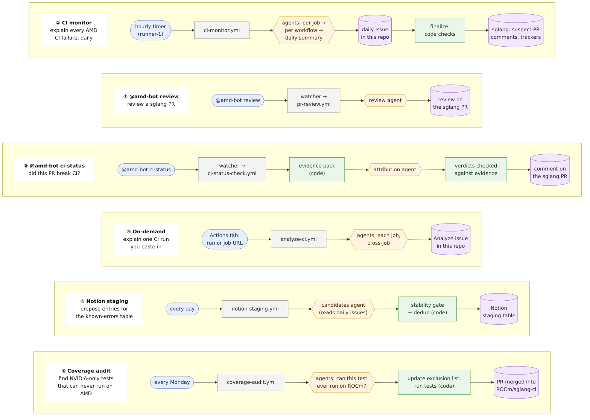

# sglang-ci-bot

The AMD CI bot for [sglang](https://github.com/sgl-project/sglang). It watches AMD CI, explains failures, names the PRs that broke it, and reviews PRs on request. It posts as **[amd-bot](https://github.com/amd-bot)**. The analysis is done by Claude Code agents running on self-hosted runners that reach Claude through the AMD LLM Gateway.

This README is the map of the repo: what each part does and why. Implementation details live in the code it links to. If you read only two sections, read [The big picture](#1-the-big-picture) and [Design rules](#3-design-rules). **Changing the repo, by hand or with an AI tool?** Read [Changing this repo](#changing-this-repo) first.

**Contents**

1. [The big picture](#1-the-big-picture)
2. [Feature map](#2-feature-map)
3. [Design rules](#3-design-rules) · [Hidden markers](#hidden-markers-where-the-state-lives) · [Changing this repo](#changing-this-repo)
4. [How an agent runs](#4-how-an-agent-runs)
5. [Features](#5-features): [CI monitor and daily report](#51-ci-monitor-and-the-daily-report) · [Suspect PR comments](#52-suspect-pr-comments) · [Failure Trackers](#53-failure-trackers) · [PR commands](#54-pr-commands-the-comment-watcher) · [PR review](#55-pr-review) · [PR CI status](#56-pr-ci-status-check) · [On-demand analysis](#57-on-demand-analysis) · [Notion staging](#58-notion-staging) · [Coverage audit](#59-coverage-exclusion-audit)
6. [Operations](#6-operations)
7. [Reference](#7-reference)

---

## 1. The big picture

Each feature is one lane. The bold box on the left says what it is for; the rest reads left to right: what starts it, which workflow runs, where the LLM is used, what code checks it, and where the result goes.



<sub>Source: [`docs/architecture.mmd`](docs/architecture.mmd) (Mermaid). After editing it, re-render the image with [`docs/render-diagram.sh`](docs/render-diagram.sh); `tests/test_readme.py` fails if the image is older than its source.</sub>

**Colors.** 🔵 trigger · ⬜ GitHub Actions workflow · 🟧 LLM agents · 🟩 deterministic code · 🟪 where results go.

**The one pattern to notice.** Wherever a result leaves this repo, a green box stands between the orange LLM and the purple output: the LLM proposes, and code decides what gets out. That is design rules [R2](#r2) and [R4](#r4) in picture form. Lanes ① and ④ write straight from an agent, but only into this repo's own issues. **Lane ② is the known exception:** the PR review posts the agent's text without a code gate (see R2).

Three more things the picture does not show:

- **Everything runs on the self-hosted runner containers** (`runner/`), because only they can reach the LLM gateway. The work runs as GitHub Actions jobs of this repo, plus two loops on runner-1: the hourly CI-monitor timer, and the comment watcher behind lanes ② and ③.
- **Every agent goes through one function**, [`claude_code_analyze()`](scripts/utils.py). Agents get their instructions from files under [`agent/`](agent/), never from strings in Python ([§4](#4-how-an-agent-runs)).
- **The daily issue is also state.** The summary and the `finalize` steps of lane ①, and lane ⑤, read the analyses back from it. Runners keep nothing that matters.

---

## 2. Feature map

| Feature | Trigger | Workflow → script | Agent tasks | Writes to |
|---|---|---|---|---|
| [CI monitor and daily report](#51-ci-monitor-and-the-daily-report) | runner-1, hourly | [`ci-monitor.yml`](.github/workflows/ci-monitor.yml) → [`monitor_ci.py`](scripts/monitor_ci.py), [`daily_cross_workflow_summary.py`](scripts/daily_cross_workflow_summary.py), [`order_daily_comments.py`](scripts/order_daily_comments.py) | Job Failure Analysis, Cross-Job Summary, Cross-Run Pattern Analysis, Daily Cross-Workflow Summary | Daily issue in this repo |
| [Suspect PR comments](#52-suspect-pr-comments) | `finalize` job of the CI monitor | [`suspect_pr_comments.py`](scripts/suspect_pr_comments.py) | — | Comments on merged sglang PRs; a log comment on the daily issue |
| [Failure Trackers](#53-failure-trackers) | `finalize` job of the CI monitor | [`failure_tracker.py`](scripts/failure_tracker.py) | Failure Tracker Data | One issue per tracked workflow on sgl-project/sglang |
| [PR commands](#54-pr-commands-the-comment-watcher) | `@amd-bot …` on a sglang PR | runner-1 daemon + [`comment-watcher.yml`](.github/workflows/comment-watcher.yml) → [`watch_comments.py`](scripts/watch_comments.py) | — | Dispatches the two workflows below; help replies |
| [PR review](#55-pr-review) | `@amd-bot review` | [`pr-review.yml`](.github/workflows/pr-review.yml) → [`review_pr.py`](scripts/review_pr.py) | PR Code Review | One comment on the sglang PR |
| [PR CI status](#56-pr-ci-status-check) | `@amd-bot ci-status` | [`ci-status-check.yml`](.github/workflows/ci-status-check.yml) → [`check_ci_for_pr.py`](scripts/check_ci_for_pr.py), [`ci_evidence.py`](scripts/ci_evidence.py), [`ci_verdicts.py`](scripts/ci_verdicts.py) | PR CI Status Check | One comment on the sglang PR |
| [On-demand analysis](#57-on-demand-analysis) | Actions tab, paste a run/job URL | [`analyze-ci.yml`](.github/workflows/analyze-ci.yml) → [`analyze_url.py`](scripts/analyze_url.py) | Job Failure Analysis, Cross-Job Summary | An `[Analyze]` issue in this repo |
| [Notion staging](#58-notion-staging) | 12:00 UTC daily | [`notion-staging.yml`](.github/workflows/notion-staging.yml) → [`stage_notion.py`](scripts/stage_notion.py) | SGLang AMD CI Staging Candidates | Notion staging database |
| [Coverage audit](#59-coverage-exclusion-audit) | Mondays 16:07 UTC | [`coverage-audit.yml`](.github/workflows/coverage-audit.yml) (code lives in ROCm/sglang-ci) | its own prompt, in ROCm/sglang-ci | A PR merged into ROCm/sglang-ci |

Supporting code:
- [`utils.py`](scripts/utils.py): GitHub helpers, the agent harness, worktrees, log parsing.
- [`ensure_daily_issue.py`](scripts/ensure_daily_issue.py): creates the daily issue.
- [`eval_ci_status.py`](scripts/eval_ci_status.py): scores CI-status replays.
- [`validate_live.py`](scripts/validate_live.py): runs any use case on a runner without writing to GitHub.
- [`check_pr_rules.py`](scripts/check_pr_rules.py) with [`pr-checks.yml`](.github/workflows/pr-checks.yml): enforce the [rules for changes](#changing-this-repo) on every PR.

---

## 3. Design rules

The decisions everything else follows, grouped by what they protect. Each has a stable ID, so a PR can say which rules it touches. Each also says **why** it exists and **what keeps it true**; rules kept only by review are marked *review only*.

### Safety: what the bot can touch

<a id="r1"></a>**R1. Agents read; code writes.**
- Every agent works in its own git worktree, at the exact commit under study, and loads no settings from that checkout (`--setting-sources user`). Developer skills are disabled.
- Its environment carries no posting token, and only a read-only one when `AGENT_GH_TOKEN` is set.
- Only Python code writes to GitHub or Notion.

*Why:* agents read text anyone can write (PR diffs, logs, a PR's own `.claude/settings.json`, whose hooks once could run on our runners). *Kept by:* [`tests/test_agent_tasks.py`](tests/test_agent_tasks.py) (CLI flags), [`tests/test_ci_verdicts.py`](tests/test_ci_verdicts.py) (agent environment).

<a id="r2"></a>**R2. Every write outside this repo passes a code gate.**
- New writers start in dry-run behind a repository variable.
- Posts are capped per tick and made at most once per PR (hidden markers).
- The bot @-mentions only the person who ran a command, and the author of a suspect PR asked to review a fix.

*Why:* a wrong comment on someone else's PR costs trust that is hard to win back. *Kept by:* [`tests/test_suspect_pr_comments.py`](tests/test_suspect_pr_comments.py).

**Known gap:** `@amd-bot review` posts the review agent's text as it is, with no code check in between. Closing it (code checks plus verifier agents on every finding) is an open proposal.

<a id="r3"></a>**R3. People decide.** The bot reports, attributes and suggests triage steps. It never approves, merges, prioritizes or reruns sglang work. The one automated merge is the coverage audit's, into ROCm/sglang-ci, of exclusion entries that code validated and tested.

*Why:* priority and merging need context the bot does not have. *Kept by:* review only.

### Truthfulness: what the bot says

<a id="r4"></a>**R4. The LLM judges; code decides and keeps state.** An agent finds and explains. Plain Python decides what is published and keeps every piece of state. For example:
- an agent names a suspect PR, and [`check_suspect()`](scripts/suspect_pr_comments.py) decides whether to comment;
- an agent extracts tracker rows, and [`merge_state()`](scripts/failure_tracker.py) owns `first_seen`;
- an agent gives CI-status verdicts, and [`ci_verdicts.validate()`](scripts/ci_verdicts.py) checks them against the evidence;

*Why:* models are good at reading logs and code, and unreliable at counting, remembering dates and following thresholds. *Kept by:* the tests of each of those functions.

<a id="r5"></a>**R5. Claims carry evidence.** The Ground Rules in [`agent/ground-rules.md`](agent/ground-rules.md) bind every task:
- analysis is at the test-file and test-function level;
- every commit SHA is verified, and every SHA, PR and job is a link;
- every causal claim has a confidence label (`FACT` … `SPECULATION`) and lists its disconfirming evidence;
- an in-flight fix PR is looked up before a fix is suggested;
- only completed runs count in trends.

*Why:* an unsupported claim sends engineers chasing the wrong cause. *Kept by:* the verification steps of R4 where output is published; review only elsewhere.

<a id="r6"></a>**R6. Fail closed.** Agent mode never falls back to a single-shot API call. When an agent fails, the bot publishes an "agent did not work" notice ([`agent_failure_notice()`](scripts/utils.py)) where the output would have gone, and the job fails. A verification step that cannot finish blocks posting.

*Why:* a confident shallow answer is worse than an honest "not available". *Kept by:* [`tests/test_agent_failures.py`](tests/test_agent_failures.py).

### Sustainability: how the repo stays understandable

<a id="r7"></a>**R7. Instructions live only in [`agent/`](agent/).** Python prompts are data: a `Task:` line plus metadata. Methodology and output format live in `agent/tasks/<task>.md`, and rules for every task in `agent/ground-rules.md`. [`AGENT_TASKS`](scripts/utils.py) maps each task to its file and model.

*Why:* behavior can then be reviewed as prose, in one place. *Kept by:* [`tests/test_agent_tasks.py`](tests/test_agent_tasks.py).

<a id="r8"></a>**R8. State lives on GitHub; runners are disposable; writes are idempotent.** Comments and issues carry [hidden markers](#hidden-markers-where-the-state-lives), so any tick can be re-run, any runner can take any job, and a host can be rebuilt from scratch.

*Why:* the runners are containers on one machine that gets rebuilt. *Kept by:* each feature's tests (re-runs, dedup).

<a id="r9"></a>**R9. Cost is bounded.**
- Every agent run has a turn limit and a timeout.
- Every fan-out has a cap: agents per matrix job, reviewers, findings verified, suspects verified per tick.
- Every task's model is chosen for its stakes (all use the default model today; `AGENT_TASKS` can give one a cheaper model).

*Why:* one loop without a bound spends the team's gateway quota. *Kept by:* review only. The limits are in the [environment variables](#environment-variables) table.

<a id="r10"></a>**R10. Agent changes are measured on real data.** A change to an agent's instructions or model is run on real inputs before merge, with [`validate_live.py`](scripts/validate_live.py), a CI-status replay, or a linked run, and the PR says how.

*Why:* a prompt has no compiler; its only test is its output. *Kept by:* the `Validated:` line that [`check_pr_rules.py`](scripts/check_pr_rules.py) requires.

<a id="r11"></a>**R11. This README is the map.** A change in behavior updates the matching section in the same PR. *Kept by:*
- [`tests/test_readme.py`](tests/test_readme.py): links, function names and lists match the code, and every script, workflow, agent task and environment variable is mentioned;
- [`check_pr_rules.py`](scripts/check_pr_rules.py): a behavior change without a README change fails.

### Hidden markers (where the state lives)

| Marker | Where | Meaning |
|---|---|---|
| `<!-- processed_job_ids: … -->` | each workflow's comment on the daily issue | jobs already analysed today; not analysed again |
| `<!-- ci-monitor-part: i/n -->` | workflow comments | a report split over several comments (60 KB limit) |
| `<details data-job-id data-run-url data-started-at>` | inside workflow comments | one per-job analysis; the only thing [`parse_job_analyses_from_comment()`](scripts/monitor_ci.py) reads back |
| `<!-- daily-cross-workflow-summary:start/end -->` | daily issue body | the summary, pinned above all comments |
| `<!-- ci-monitor-job-clusters:v1 … -->`, `<!-- ci-monitor-suspect-prs:v1 … -->` | inside the summary | job → cluster map and suspect PRs, for the finalize steps |
| `<!-- ci-monitor-cross-run-summary: <wf> -->` | daily issue | a workflow's cross-run comment |
| `<!-- ci-monitor-suspect-pr-log -->` | daily issue | every suspect decision this tick, and why |
| `<!-- amd-bot-suspect-pr:<cluster> -->`, `<!-- amd-bot-suspect-fix:<pr> -->` | sglang PRs | a suspect comment / a fix-review request was posted |
| `<!-- ci-failure-tracker-state: … -->` | Failure Tracker issue body | every failure's `first_seen` / `last_seen` |
| 🚀 reaction by amd-bot | the `@amd-bot` comment | the command was claimed; no other watcher dispatches it |

### Changing this repo

These rules apply to every change, whether typed by hand or written by an AI tool. [`AGENTS.md`](AGENTS.md) is the only file that holds them, for every tool. Codex, Cursor, Copilot and most others read it natively; Claude Code reads it through [`CLAUDE.md`](CLAUDE.md), which is the single line `@AGENTS.md`. Any tool-specific rules file may only point to `AGENTS.md` ([`tests/test_agent_rules.py`](tests/test_agent_rules.py) enforces this), so there is never a second copy to keep in sync. And whichever tool wrote a change, [`pr-checks.yml`](.github/workflows/pr-checks.yml) checks the result.

1. **Read §1–§3 first.** Extend the existing patterns (the agent harness, hidden markers, code gates, dry-run variables) rather than inventing parallel ones.
2. **Stay on direction.** Do not break a design rule silently. A change that bends one names it in the PR, says why, and updates the rule here, which needs the repo owner's approval.
3. **One concern per PR.** No drive-by refactors, renames or reformatting, so every diff is reviewable.
4. **Update this README in the same PR**, following the section map in `AGENTS.md`, along with tests for the new behavior.
5. **Fill in the three lines of the [PR template](.github/pull_request_template.md):**
   - `README:` the sections updated, or `not needed — <reason>`;
   - `Design rules:` `none`, or the rule IDs touched;
   - `Validated:` how an agent change ran on real data (R10).

[`pr-checks.yml`](.github/workflows/pr-checks.yml) runs the unit tests and [`check_pr_rules.py`](scripts/check_pr_rules.py) on every pull request. It fails a PR that misses any of the above. Making it a required status check for `main` in branch protection is what makes the rules binding.

---

## 4. How an agent runs

Every agent run goes through [`claude_code_analyze()`](scripts/utils.py):

1. The prompt's first line names the task (`Task: Job Failure Analysis`). [`AGENT_TASKS`](scripts/utils.py) maps the task to its instructions file and model; an unknown task fails before anything starts.
2. The instructions, [`agent/ground-rules.md`](agent/ground-rules.md) followed by `agent/tasks/<task>.md` ([`agent_instructions()`](scripts/utils.py)), are passed with `--append-system-prompt`. Nothing is read from the checkout's own `CLAUDE.md` or `.claude/`.
3. Context files the script prepared (logs, evidence packs, other agents' output) are written to `.ci-context/` in the working directory and removed afterwards.
4. It runs `claude -p` in the worktree:
   - flags: `--setting-sources user --disable-slash-commands --dangerously-skip-permissions`, with a turn limit and a timeout;
   - environment: no `BOT_PAT` or `LLM_GATEWAY_KEY`, and `AGENT_GH_TOKEN` in place of `GH_PAT` when set.
5. The text output is returned. When the final message misses the expected report (empty, or overwritten by a follow-up), the report is recovered from the session log. When `AGENT_ARCHIVE_DIR` is set, the prompt and session are archived with secrets redacted.

Each agent works in an isolated worktree of a shared sglang clone ([`ensure_sglang_repo()`](scripts/utils.py), [`create_agent_worktree()`](scripts/utils.py)), checked out at the exact commit the CI run or PR used. The clone is re-made if it is broken (an interrupted clone once left runner-7 with no `HEAD`).

| `Task:` | Instructions | Model | Called from |
|---|---|---|---|
| Job Failure Analysis | [`job-failure-analysis.md`](agent/tasks/job-failure-analysis.md) | default | [`analyze_job_with_agent()`](scripts/utils.py) |
| Cross-Job Summary | [`cross-job-summary.md`](agent/tasks/cross-job-summary.md) | default | [`cross_job_analysis()`](scripts/utils.py) |
| Cross-Run Pattern Analysis | [`cross-run-pattern-analysis.md`](agent/tasks/cross-run-pattern-analysis.md) | default | [`maybe_publish_cross_run_summary()`](scripts/monitor_ci.py) |
| Daily Cross-Workflow Summary | [`daily-cross-workflow-summary.md`](agent/tasks/daily-cross-workflow-summary.md) | default | [`build_and_publish_summary()`](scripts/daily_cross_workflow_summary.py) |
| Failure Tracker Data | [`failure-tracker-data.md`](agent/tasks/failure-tracker-data.md) | default | [`run_agent_extraction()`](scripts/failure_tracker.py) |
| SGLang AMD CI Staging Candidates | [`staging-candidates.md`](agent/tasks/staging-candidates.md) | default | [`analyze()`](scripts/stage_notion.py) |
| PR CI Status Check | [`pr-ci-status-check.md`](agent/tasks/pr-ci-status-check.md) | default | [`check_ci_for_pr()`](scripts/check_ci_for_pr.py) |
| PR Code Review | [`pr-code-review.md`](agent/tasks/pr-code-review.md) | default | [`review_pr_with_agent()`](scripts/review_pr.py) |

**Models.** Every task uses the runner's `ANTHROPIC_MODEL` (`opus[1m]`) unless `AGENT_TASKS` gives it its own.
- `AGENT_MODEL_<TASK>` overrides the model for one task, e.g. `AGENT_MODEL_FAILURE_TRACKER_DATA=sonnet`.
- An alias such as `sonnet` is used only when `claude.env` maps it (`ANTHROPIC_DEFAULT_SONNET_MODEL`); otherwise the task keeps the default model.
- If the gateway has no deployment of the requested model, the task is retried once with the default ([`task_model()`](scripts/utils.py)).

**Output contracts.** Reports start with a fixed first line (`### Commit Info`, `**Counts**:`, `# Daily Cross-Workflow Summary`), and the harness strips anything before it. Machine-readable results come in hidden or fenced blocks that code parses and validates: `ci-status-verdicts`, `job-clusters`, `suspect-prs`, and tracker data.

---

## 5. Features

### 5.1 CI monitor and the daily report

**Purpose.** One GitHub issue per UTC day in this repo, `[CI Monitor] Daily Report - <date>`. It holds a per-workflow failure report for every monitored AMD workflow, plus a cross-workflow summary pinned at the top of the issue body.

**Flow** ([`ci-monitor.yml`](.github/workflows/ci-monitor.yml), dispatched hourly by runner-1's [`entrypoint.sh`](runner/entrypoint.sh)):

1. **prepare**: [`ensure_daily_issue.py`](scripts/ensure_daily_issue.py) creates today's issue, with the summary placeholder, once, before the matrix starts, so parallel jobs cannot create duplicates.
2. **monitor** (a matrix of one job per workflow, up to 8 at a time), running [`run_oneshot()`](scripts/monitor_ci.py) → [`monitor_workflow()`](scripts/monitor_ci.py):
   1. **Find the failed jobs.** It lists the workflow's failed and in-progress runs in the last 24 h. Most workflows count scheduled runs only; AMD AITER Scout also counts manual runs ([`workflow_event_filter()`](scripts/monitor_ci.py)). Gate and finish jobs are skipped ([`is_gate_job()`](scripts/utils.py)), and so are jobs already in `processed_job_ids`.
   2. **Analyse each new failed job.** Each gets a Job Failure Analysis agent at the run's commit, 3 in parallel. Some workflows get extra context:
      - `nightly-amd-mi355x-disagg.yml`: the run's server-log artifacts are downloaded ([`prepare_mi355x_artifact_context()`](scripts/utils.py)).
      - Miles workflows: the worktree is moved to the image's sglang commit, radixark/miles is added, and dashboard evidence is written ([`prepare_miles_context()`](scripts/utils.py)).
      - Jobs whose runner was lost: the facts are passed instead of a missing log ([`is_runner_lost()`](scripts/utils.py)).
      - A job already analysed on an earlier day is copied over, not analysed again.
   3. **Summarise the workflow.** A Cross-Job Summary groups the jobs into symptom clusters. A Cross-Run Pattern Analysis runs when the window holds two or more runs.
   4. **Publish.** It renders and edits the workflow's comment(s) on the daily issue ([`publish_workflow_report()`](scripts/monitor_ci.py)).
   5. **Refresh the summary.** If anything was new, it rebuilds the Daily Cross-Workflow Summary in the issue body ([`build_and_publish_summary()`](scripts/daily_cross_workflow_summary.py)). This step reads every workflow's comments back, adds yesterday's summary for trends, and keeps the summary's `job-clusters` and `suspect-prs` blocks as hidden comments.
3. **finalize** (once, after the matrix):
   1. [`order_daily_comments.py`](scripts/order_daily_comments.py) puts the reports in priority order.
   2. [Suspect PR comments](#52-suspect-pr-comments).
   3. [Failure Trackers](#53-failure-trackers).

**Things to know**
- **Report order** follows [`MONITORED_WORKFLOWS`](scripts/monitor_ci.py): Docker builds, PR test, nightly, disagg, Miles, AITER Scout. Inside `pr-test-amd.yml`, jobs are grouped by ROCm version (`ROCM_REPORT_ORDER`), PRs' default first, then by stage (`JOB_REPORT_ORDER`).
- **Every summary layer can fail independently.** If the summary agent fails, the last good summary stays up under a "not refreshed" note and the next tick retries it.
- **The report date is pinned when a run starts**, so an agent that runs past midnight cannot write into the next day's issue.
- **Miles workflows** test radixark/miles images. They appear in the report and summary, but not in Notion staging or the Failure Trackers; their failures are radixark/miles' to triage.

### 5.2 Suspect PR comments

**Purpose.** When the daily summary attributes a failure cluster to a merged sglang PR, tell that PR's author on the PR.

**Flow** ([`suspect_pr_comments.py`](scripts/suspect_pr_comments.py), every tick, in `finalize`):

1. **Code checks** ([`check_suspect()`](scripts/suspect_pr_comments.py)), in order. A suspect is dropped at the first check it fails:
   - confidence is `FACT` or `HIGH`;
   - the cluster has at least 2 failed jobs;
   - the last-passing and first-failing commits are given;
   - the PR was merged within 14 days, and the cited commit is the PR's;
   - the compare API puts the commit inside the window;
   - an open fix PR, if one is linked, is by someone else (a merged fix skips the suspect);
   - the PR has no earlier suspect comment, for any cluster ID, since cluster IDs change daily.
2. **Post**: at most 3 comments per tick, strongest first. A comment states what fails, the commit window, and up to 8 job links, and asks the author to say so if their PR is not the cause. With an open fix PR, the comment instead @-mentions the author and asks them to review the fix, once per fix PR.
3. **Log**: one comment on the daily issue records every decision and why.

**Modes**, set by the repository variable `SUSPECT_PR_COMMENTS`: `dry-run` (the default: nothing is posted upstream, only the log), `post`, or `off`.

### 5.3 Failure Trackers

**Purpose.** One long-lived issue on sgl-project/sglang per tracked workflow, `[Failure Tracker] <name>`. It lists every test failure that workflow has shown and how long it has been red, beyond the daily report's 24 h window and GitHub's log retention.

**Flow** ([`update_trackers()`](scripts/failure_tracker.py), once per tick in `finalize`):
1. **Content.** A small, JSON-only agent task (Failure Tracker Data) reads the same per-job analyses as the daily report. If the agent fails, [`deterministic_rows()`](scripts/failure_tracker.py) parses each analysis's `Failed Tests` table instead.
2. **State.** [`merge_state()`](scripts/failure_tracker.py) keeps each failure, keyed by test file and function, in a hidden JSON blob in the issue body:
   - an existing failure keeps its `first_seen` and only updates `last_seen`;
   - a new failure is dated today;
   - nothing is ever deleted or re-dated.

   The LLM is never asked to remember dates.
3. **Render** the table, linking each row back to its analysis in that day's daily issue.

Tracked workflows are configured in [`TRACKED_WORKFLOWS`](scripts/failure_tracker.py), currently `pr-test-amd.yml`. Adding an entry is all it takes to get a new tracker.

### 5.4 PR commands: the comment watcher

[`watch_comments.py`](scripts/watch_comments.py) polls sglang PR comments for commands that start a line with `@amd-bot`:

| Command | Does |
|---|---|
| `@amd-bot review` | [PR review](#55-pr-review) |
| `@amd-bot review-focus <areas>` | the same, with the areas passed to the reviewer |
| `@amd-bot ci-status` | [PR CI status check](#56-pr-ci-status-check) |
| `@amd-bot help` | posts the command list |

- **Who can run them.** Only users in [`AUTHORIZED_USERS`](scripts/watch_comments.py). A mention inside a sentence or a quote-reply runs nothing. An unknown command gets the help reply. Hyphenated commands also work with a space.
- **Two watchers.** A daemon on runner-1 polls every 15 s (fast path), and [`comment-watcher.yml`](.github/workflows/comment-watcher.yml) polls every 5 min (safety net while runner-1 restarts).
- **Claiming.** Both watchers claim a comment with a 🚀 reaction before dispatching, so a command runs once ([`has_bot_claimed()`](scripts/watch_comments.py)).
- **Dispatch.** A claimed command becomes a `repository_dispatch` of `pr-review.yml` or `ci-status-check.yml`. Both workflows use a per-comment concurrency group, so a duplicate dispatch is cancelled.

### 5.5 PR review

**Purpose.** A review of a sglang PR on request.

**Flow** ([`review_pr()`](scripts/review_pr.py)):
1. A worktree is checked out at the PR's head ([`agent_worktree()`](scripts/utils.py)).
2. One agent (`PR Code Review`, [`review_pr_with_agent()`](scripts/review_pr.py)) reads the diff and the full source files, finds callers of changed functions, and checks AMD/ROCm parity and test coverage.
3. Its text is posted as one comment with Summary, Code Quality, Suggestions, Testing and Overall sections.

It does not meet design rule R2 yet: nothing checks the agent's findings before they are posted (the known gap in R2). If the agent fails, the PR gets the "agent did not work" notice. API mode (`USE_AGENT=false`) sends the diff to Claude in a single call ([`review_pr_with_claude()`](scripts/review_pr.py)).

### 5.6 PR CI status check

**Purpose.** For each CI job that ran and failed on the PR's head, decide whether **this PR** caused it. Also flag when PR CI is incomplete (fast-fail cascades, gates), or when the AMD test that covers the change never ran.

**Flow** ([`check_ci_for_pr()`](scripts/check_ci_for_pr.py)):
1. **Evidence pack.** [`build_evidence_pack()`](scripts/ci_evidence.py) collects, for every failed job:
   - the failing tests, a log excerpt and the raw metrics of each attempt;
   - the commit CI actually tested, which is usually a merge commit;
   - the CI image and its real `ENV`, the GPU, launch configs, backend lines and the aiter modules loaded;
   - the same test in recent comparable `main` runs.

   Every fact gets an ID. The worktree is checked out at the commit CI tested.
2. **Agent.** The agent attributes each failure (🔴 related / 🟡 possibly / 🟢 unrelated / ⚪ unknown) and ends with a hidden verdict block citing evidence IDs.
3. **Check.** [`validate()`](scripts/ci_verdicts.py) checks every verdict against the pack. For example, `related` needs the full chain: diff → the changed path ran → the failure. A row that fails the check is shown as ⚪ unverified, with a warning.
4. **Coverage banner.** [`detect_untested_amd_changes()`](scripts/check_ci_for_pr.py) computes, in code, a banner shown when AMD CI did not run, or when the suite covering a changed test file did not run.

These checks exist because of sgl-project/sglang#40771. There the bot read the PR head instead of the commit CI tested, judged a feature off from its code default while the image turned it on, and called a PR-caused accuracy drop unrelated. Replays with `--head-sha` / `--as-of` and the hand-labelled cases in [`evals/ci_status/cases/`](evals/ci_status/cases/) are scored by [`eval_ci_status.py`](scripts/eval_ci_status.py).

### 5.7 On-demand analysis

Paste a run or job URL into **Actions → Analyze CI**. [`run_analysis()`](scripts/analyze_url.py) analyses every failed job of the run (or the one job), adds a Cross-Job Summary when there are several, and writes it all into an `[Analyze] <workflow> run #<id>` issue in this repo. Use it for manual or PR runs, which the daily monitor ignores.

### 5.8 Notion staging

**Purpose.** Propose new entries for the team's Notion table of known AMD CI errors. Only failures that are clearly stable qualify, and they go to a separate staging table that a person reviews.

**Flow** ([`stage_notion.py`](scripts/stage_notion.py), 12:00 UTC daily):
1. **`analyze`.** An agent reads the last 7 daily reports and proposes canonical failures. Code keeps a candidate only if the same signature appears in two or more completed comparable runs with no later pass ([`validate_candidate()`](scripts/stage_notion.py)).
2. **`sync`.** Plain code with no agent:
   - reads the official known-errors table and the staging table, and skips matches;
   - writes new rows only to the staging table, with `Status` left blank;
   - verifies the rows it created, and that the official table is unchanged.

The agent never receives the Notion token. Manual runs default to `dry-run`.

### 5.9 Coverage exclusion audit

**Purpose.** Keep the AMD test-coverage number honest.
- ROCm/sglang-ci's `/coverage` page lists the sglang tests that run on NVIDIA CI but not on AMD CI, and computes AMD coverage from that list.
- Some of those tests can never run on AMD (CUDA-only kernels, NVIDIA-only features). They are not real gaps, and counting them understates coverage and sends people after tests that should not be ported.

**Flow** ([`coverage-audit.yml`](.github/workflows/coverage-audit.yml), every Monday):
1. Find the tests that newly appeared in the gap list.
2. Agents read each test file and decide whether it can ever run on ROCm, and why.
3. Code validates the answers and adds the never-on-ROCm tests to `AMD_EXCLUSION_REASONS`.
4. It runs ROCm/sglang-ci's tests, and checks that the gap list shrank by exactly those files.
5. It opens a PR in ROCm/sglang-ci and merges it (`--admin`).

It runs in this repo only because these runners can reach the LLM gateway. Its code, prompt and ledger live in ROCm/sglang-ci (`upstream_ci/coverage_audit/`).

It is the most isolated job in this repo:
- it works in `$RUNNER_TEMP`;
- its agent runs under `env -i` with only `Read,Grep,Glob` (`--restricted`), no token and no settings;
- every answer is validated before any write.

It acts as the owner of `SGLANG_CI_TOKEN` (or `GH_PAT`), who must be an admin on ROCm/sglang-ci with ROCm SSO authorized. For a manual dry run, use Actions → Coverage Exclusion Audit → `dry_run`.

---

## 6. Operations

### Accounts and tokens

| Account | Role |
|---|---|
| **bingxche** | Owns this repo; registers the self-hosted runners (needs admin) |
| **amd-bot** | Posts every public comment, review and reaction on sglang |

| Token | Used for |
|---|---|
| `secrets.GH_PAT` (amd-bot's PAT, `repo` scope) | Workflows: reading GitHub, posting as amd-bot |
| `GH_PAT` given to `setup.sh` (bingxche's PAT: `repo`, `workflow`, `admin:repo_hook`) | Registering the runners; runner-1's hourly `ci-monitor.yml` dispatch |
| `BOT_PAT` given to `setup.sh` (`--bot-pat`, optional) | runner-1's comment watcher. Without it the watcher uses the `--pat` token, so its 🚀 claims come from that account (the current deployment) |
| `secrets.AGENT_GH_TOKEN` (optional, read-only) | Handed to agents in place of `GH_PAT` |
| `secrets.SGLANG_CI_TOKEN` (optional) | Coverage audit, in place of `GH_PAT` |

### Repository secrets and variables

Settings → Secrets and variables → Actions.

| Secret | Value |
|---|---|
| `GH_PAT` | amd-bot's GitHub PAT |
| `LLM_GATEWAY_KEY` / `LLM_GATEWAY_URL` | AMD LLM Gateway key and endpoint (e.g. `https://llm-api.amd.com/Anthropic`) |
| `AGENT_GH_TOKEN` | Recommended: a read-only token for the CI-status agents, which read content anyone can write |
| `NOTION_TOKEN` | Notion connection with Read + Insert, no Update, shared only with the two databases |
| `SGLANG_CI_TOKEN` | Optional: another ROCm/sglang-ci admin's PAT for the coverage audit |

| Variable | Value |
|---|---|
| `USE_AGENT` | `true`: agent mode for review and CI status (API mode otherwise) |
| `SUSPECT_PR_COMMENTS` | `dry-run` (default), `post`, `off` |
| `COVERAGE_AUDIT_MODEL` | Optional `--model` for the coverage audit (default `opus`) |
| `NOTION_KNOWN_DATA_SOURCE_ID` / `NOTION_STAGING_DATA_SOURCE_ID` | The official (read-only) and staging (write) Notion data sources; they must differ |

### Runners

[`runner/setup.sh`](runner/setup.sh) builds the runner image ([`runner/Dockerfile`](runner/Dockerfile): Python 3.12, Node 22, the pinned Claude Code CLI) and starts 10 containers. Runners 2–10 only run jobs. Runner-1 also runs the comment watcher daemon and the hourly `ci-monitor.yml` dispatch ([`runner/entrypoint.sh`](runner/entrypoint.sh)).

```bash
bash runner/setup.sh --pat <bingxche PAT> --claude-env .secrets/claude.env --use-agent
```

Options: `--bot-pat`, `--llm-gateway-key` / `--llm-gateway-url`, `--image <registry image>` (pull instead of build), `--build`, `--count`, `--name`, `--repo`. Re-running `setup.sh` replaces the containers. GitHub can show the runners offline for a few minutes afterwards ("A session for this runner already exists"), until the old sessions expire.

`.secrets/claude.env` (gitignored) configures Claude Code in every container:

```
ANTHROPIC_API_KEY=dummy
ANTHROPIC_BASE_URL=https://llm-api.amd.com/Anthropic
ANTHROPIC_CUSTOM_HEADERS=Ocp-Apim-Subscription-Key: <your-key>
ANTHROPIC_MODEL=opus[1m]
ANTHROPIC_DEFAULT_OPUS_MODEL=Claude-Opus-5.5
ANTHROPIC_DEFAULT_SONNET_MODEL=Claude-Sonnet-5.5
ANTHROPIC_DEFAULT_HAIKU_MODEL=Claude-Haiku-5.5
CLAUDE_CODE_DISABLE_NONESSENTIAL_TRAFFIC=1
```

Each alias must name a model the gateway serves. A stale one (once `Claude-Sonnet-4.7`) makes those tasks fall back to the default model. A new model can need a newer CLI: bump the version pinned in `runner/Dockerfile` and rebuild.

Containers share nothing with the host except the read-only `entrypoint.sh` and a tool-cache volume. The bot code is cloned to `/tmp/bot`; sglang is cloned on demand to `/workspace/sglang`.

### Applying changes

| What changed | Workflows | runner-1 daemons |
|---|---|---|
| `scripts/`, `agent/` | next run picks it up after `git push` | `docker restart amd-ci-bot-runner-1` |
| `.github/workflows/` | immediately | — |
| `runner/entrypoint.sh` | — | `git pull` on the host + restart runner-1 |
| `runner/Dockerfile`, `.secrets/claude.env` | — | re-run `setup.sh` |
| Secrets / variables | immediately | — |

Logs: `docker logs -f amd-ci-bot-runner-1`. Restart all: `for i in $(seq 1 10); do docker restart amd-ci-bot-runner-$i; done`.

### Testing and validating a change

```bash
# Unit tests (standard library unittest)
PYTHONPATH=scripts python3 -m unittest discover -s tests -p 'test_*.py'

# Any use case on a runner, with every GitHub write blocked (run inside a runner container)
python3 scripts/validate_live.py monitor|crossrun|daily|tracker|staging|cistatus|review

# CI-status replay and scoring against hand-labelled cases
python scripts/check_ci_for_pr.py 40771 --no-post --head-sha <sha> --as-of <time> --out-dir runs/40771
python scripts/eval_ci_status.py --runs runs
```

`validate_live.py` reads `VALIDATE_WORKFLOW`, `VALIDATE_HOURS`, `VALIDATE_JOB_FILTER`, `VALIDATE_PR`, `VALIDATE_DATE`, `VALIDATE_LOOKBACK`. Give each case its own `AGENT_WORKSPACE`, so it does not touch the runner's `/workspace`.

### Disaster recovery

The bot is stateless: all state is on GitHub. To move it to a new host, install Docker, clone this repo, copy `.secrets/claude.env`, and run `setup.sh` with the PATs. Check `docker ps` (10 containers), the runners page (online), and `docker logs amd-ci-bot-runner-1` (watcher and monitor loop started).

---

## 7. Reference

### Monitored workflows

[`MONITORED_WORKFLOWS`](scripts/monitor_ci.py), in report order:

```
release-docker-amd-rocm10.yml
release-docker-amd-rocm720-nightly.yml
release-docker-amd-gfx1151-nightly.yml
release-docker-amd-miles-rocm10-nightly.yml
release-docker-amd-miles-rocm724-nightly.yml
pr-test-amd.yml
nightly-test-amd.yml
nightly-amd-mi355x-disagg.yml
nightly-test-amd-miles-rocm10.yml
nightly-test-amd-miles-rocm10-mi30x.yml
amd-aiter-scout.yml
```

The same list is `DEFAULT_WORKFLOWS` in [`ci-monitor.yml`](.github/workflows/ci-monitor.yml). Upstream runs ROCm 10, 7.2.4 and 7.2 as matrix legs inside `pr-test-amd.yml` and `nightly-test-amd.yml`. `amd-ci-job-monitor.yml` (housekeeping) and the tag-only `release-docker-amd.yml` are not monitored.

### Command lines

Every script prints its options with `--help`. The common ones:

```bash
python scripts/monitor_ci.py --output stdout --hours-back 24 --workflows pr-test-amd.yml
python scripts/daily_cross_workflow_summary.py --bot-repo bingxche/sglang-ci-bot [--date YYYY-MM-DD]
python scripts/suspect_pr_comments.py --bot-repo bingxche/sglang-ci-bot --mode dry-run
python scripts/failure_tracker.py --bot-repo bingxche/sglang-ci-bot [--no-use-agent]
python scripts/review_pr.py 1234 --no-post [--focus "..."]
python scripts/check_ci_for_pr.py 1234 --no-post
python scripts/analyze_url.py --url <run or job URL> [--bot-repo bingxche/sglang-ci-bot]
python scripts/stage_notion.py analyze --bot-repo bingxche/sglang-ci-bot --output out.json
python scripts/stage_notion.py sync --input out.json --dry-run
```

Agent mode is the default everywhere; `--no-use-agent` (or `USE_AGENT=false`) selects API mode.

### Environment variables

| Variable | Used by | Description |
|---|---|---|
| `GH_PAT` / `BOT_PAT` / `GITHUB_TOKEN` | all scripts | GitHub token, in that order of preference by most scripts |
| `BOT_REPO` | `ensure_daily_issue.py`, `order_daily_comments.py` | The bot repo hosting the daily issue |
| `LLM_GATEWAY_KEY` / `LLM_GATEWAY_URL` | API mode | AMD LLM Gateway key and endpoint |
| `USE_AGENT` | all scripts | `false` / `0` / `no` selects API mode (default: agent mode) |
| `ANTHROPIC_API_KEY` / `ANTHROPIC_BASE_URL` / `ANTHROPIC_CUSTOM_HEADERS` / `ANTHROPIC_MODEL` | Claude Code | Gateway access and default model, from `claude.env` |
| `AGENT_MODEL_<TASK>` | agent mode | Model for one task (e.g. `AGENT_MODEL_FAILURE_TRACKER_DATA`), overriding `AGENT_TASKS` |
| `AGENT_WORKSPACE` | agent mode | Base directory for the sglang clone and worktrees (default `/workspace`) |
| `AGENT_GH_TOKEN` | agent mode | Read-only token given to agents in place of `GH_PAT` / `GH_TOKEN` |
| `AGENT_ARCHIVE_DIR` | agent mode | Copy each agent's prompt and session log (secrets redacted) here; the CI-status workflow uploads it |
| `AGENT_PARALLEL` | `monitor_ci.py` | Agents per matrix job (default 3) |
| `AGENT_TIMEOUT_SECS` / `AGENT_MAX_TURNS` | per-job analysis, daily summary | Per-job timeout (1500 in the workflow, 1800 in code) and turns (150 in the workflow; 1000 per job, 200 for the summary in code) |
| `CROSS_JOB_TIMEOUT_SECS` / `CROSS_JOB_MAX_TURNS` | `utils.cross_job_analysis` | Cross-Job Summary budget (1200 s, 100 turns) |
| `CROSS_RUN_TIMEOUT_SECS` | `monitor_ci.py` | Cross-Run Pattern Analysis timeout (600 s) |
| `DAILY_SUMMARY_TIMEOUT_SECS` | `daily_cross_workflow_summary.py` | Summary agent timeout (1200 s) |
| `BUILD_DAILY_SUMMARY` | `monitor_ci.py` | `false` skips the summary refresh (legacy alias `BUILD_DAILY_BOARD`) |
| `MILES_CAUSE_FIX_URL` | Miles analyses | The sglang-ci dashboard's Miles cause/fix payload (default `https://rocm.github.io/sglang-ci/api/miles/cause-fix.json`) |
| `TRACKER_AGENT_TIMEOUT_SECS` / `TRACKER_AGENT_MAX_TURNS` | `failure_tracker.py` | Tracker extraction budget (900 s, 80 turns) |
| `SUSPECT_PR_COMMENTS` | `suspect_pr_comments.py` | Mode: `dry-run`, `post` or `off` |
| `CI_STATUS_AGENT_TIMEOUT` / `CI_STATUS_OUT_DIR` | `check_ci_for_pr.py` | Agent timeout (2400 s); where to save the evidence pack and verdicts |
| `STAGING_AGENT_TIMEOUT_SECS` / `STAGING_AGENT_MAX_TURNS` | `stage_notion.py analyze` | Staging agent budget (1200 s, 120 turns) |
| `NOTION_TOKEN` / `NOTION_KNOWN_DATA_SOURCE_ID` / `NOTION_STAGING_DATA_SOURCE_ID` | `stage_notion.py sync` | Notion access; never present in the agent step |
| `SGLANG_CI_TOKEN` | `coverage-audit.yml` | ROCm/sglang-ci token, in place of `GH_PAT` |
| `COMMENT_AUTHOR` | review, CI status | Set by the watcher; shown as "requested by" |
| `PR_BODY` | `check_pr_rules.py` | The PR description, passed by `pr-checks.yml` (or `--body-file`) |
| `VALIDATE_*` | `validate_live.py` | See [Testing and validating a change](#testing-and-validating-a-change) |

### Repository layout

```
agent/            AI behavior, and nothing else
  ground-rules.md   Ground Rules for every task
  tasks/            one methodology + output format per Task: line
  api-prompts.md    API-mode prompt templates
scripts/          everything that runs (see the feature map)
tests/            unittest suites, one per script area; test_readme.py checks this README
evals/            hand-labelled CI-status cases
runner/           Dockerfile, setup.sh, entrypoint.sh for the self-hosted runners
docs/             architecture.mmd (diagram source), architecture.png (rendered), render-diagram.sh
.github/
  workflows/        one workflow per feature, plus pr-checks.yml
  pull_request_template.md   the README / Design rules / Validated lines
AGENTS.md         the only rules for changing this repo, read by every AI tool
CLAUDE.md         the one line @AGENTS.md, for Claude Code (the bot's own agents never load it)
```
